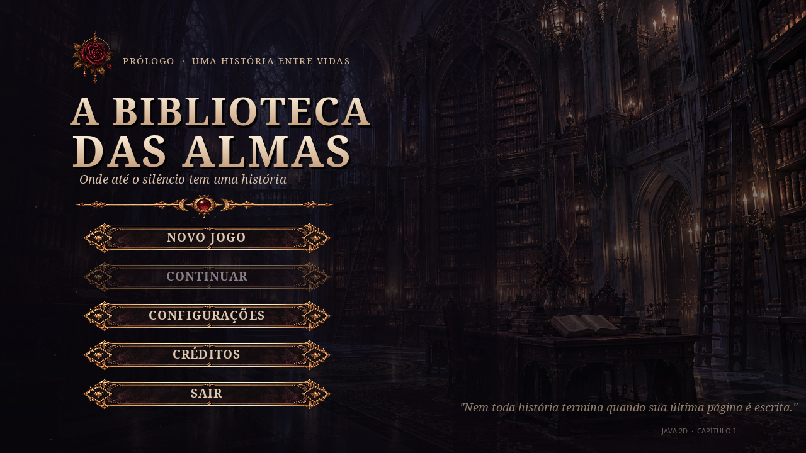

<div align="center">

# A Biblioteca das Almas

**Uma história sobre memória, escolhas e o direito de escrever o próprio destino.**

*RPG narrativo de fantasia gótica desenvolvido em Java 2D.*



**Java 21** · **Swing / Graphics2D** · **Maven** · **Visual novel** · **Exploração point-and-click**

</div>

---

## Sobre o projeto

**A Biblioteca das Almas** é um jogo narrativo de mistério e fantasia gótica ambientado em uma biblioteca sobrenatural onde a existência das pessoas é preservada em livros. A experiência combina **exploração de cenários estáticos**, investigação de objetos, diálogos com personagens, recuperação de memórias e **escolhas que alteram o desfecho da história**.

O jogador acompanha **Natasha Rostova**, que desperta nos degraus de uma biblioteca sem se lembrar de como chegou ali. Ao investigar o lugar, ela encontra um bibliotecário que conhece seu nome, uma figura fantasmagórica que carrega histórias esquecidas e uma entidade que controla os registros das almas. Aos poucos, Natasha descobre que sua ligação com a biblioteca é muito mais antiga do que imagina.

O jogo não utiliza movimentação livre ou combate: a navegação acontece por **cliques em áreas interativas (*hotspots*)**, com destaque para a atmosfera, a leitura e as consequências das decisões.

> **Estado do desenvolvimento:** o **menu inicial e um prólogo demonstrativo já são executáveis**. O roteiro completo do Capítulo I foi estruturado em JSON, mas ainda precisa ser conectado ao motor de diálogos, à exploração definitiva e aos três finais jogáveis. Veja [Andamento do desenvolvimento](#andamento-do-desenvolvimento).

## Capítulo I — O Nome que Não Deveria Existir

O primeiro capítulo acompanha Natasha em uma investigação pela biblioteca. Cada ambiente revela uma parte da relação entre as memórias, os registros e a liberdade das almas.

O capítulo foi planejado com **26 cenas narrativas**, incluindo uma cena final com três variações, representadas em **28 arquivos JSON de cena**. A previsão inicial de duração é de **25 a 40 minutos**, sujeita a ajustes após testes.

### Personagens

| Personagem | Papel na narrativa |
| --- | --- |
| **Natasha Rostova** | Protagonista. Investiga o próprio passado e aprende a lidar com as consequências de decisões que não consegue recordar. |
| **Rodion Raskólnikov** | Bibliotecário reservado e irônico. Conhece os registros e esconde informações por medo de repetir um erro do passado. |
| **A Fantasma** | Uma alma gentil que absorveu vestígios de histórias apagadas para proteger outras pessoas, apesar do sofrimento que isso lhe causa. |
| **O Escriba** | Entidade sem rosto que administra os registros. Acredita que controlar as histórias é a única maneira de impedir que desapareçam. |

### Ambientes

| Área | Função no jogo |
| --- | --- |
| **Entrada da Biblioteca** | Despertar de Natasha, primeira investigação e carta misteriosa. |
| **Salão Principal** | Centro de exploração, descoberta dos livros e acesso às demais áreas. |
| **Balcão de Rodion** | Conversas, pistas e revelações sobre os registros. |
| **Corredor dos Livros Esquecidos** | Encontro com a Fantasma, fotografia e medalhão. |
| **Arquivo Proibido** | Descoberta do livro de Natasha, memórias e regras ocultas. |
| **Câmara dos Registros** | Confronto com o Escriba e decisão que determina o final. |

### Mecânicas narrativas planejadas

- **Diálogos ramificados:** respostas que mudam a postura de Natasha e as reações dos personagens.
- **Investigação:** interação com livros, portas, cartas, fotografias e documentos.
- **Inventário:** armazenamento de pistas e objetos relevantes para a história.
- **Diário de memórias:** acompanhamento de lembranças recuperadas e descobertas.
- **Cutscenes:** ilustrações exibidas nos momentos de maior impacto narrativo.
- **Três finais:** dois acessíveis pela progressão principal e um terceiro condicionado à investigação completa.
- **Salvamento de progresso:** persistência do estado da partida, escolhas e descobertas.

<details>
<summary><strong>Detalhes da história e condições dos finais (spoilers)</strong></summary>

Natasha já esteve na biblioteca e aceitou um pacto para impedir que determinadas almas fossem apagadas. O vínculo criado com seu próprio livro, porém, passou a ser usado pelo Escriba para mantê-las aprisionadas. Rodion a ajudou na primeira tentativa e esconde a verdade por medo de que ela se sacrifique novamente.

O capítulo apresenta três desfechos:

1. **A Última Página:** Natasha destrói o livro, liberta as almas vinculadas e sacrifica sua própria existência.
2. **Entre Páginas Fechadas:** Natasha preserva o livro e sobrevive, mas o ciclo de aprisionamento continua.
3. **A História que Ainda Não Foi Escrita:** Natasha reescreve o pacto, devolve às almas o direito sobre suas histórias e derrota o Escriba. Ela sobrevive, mas aceita que parte de seu passado continuará desconhecida.

O terceiro final exige: memória da carta, memória da fotografia, memória do pacto, confiança da Fantasma e descoberta da cláusula de reescrita. Essas condições são previstas no roteiro JSON e **ainda não estão implementadas como jogabilidade no menu atual**.

</details>

## Tecnologias

| Tecnologia | Uso |
| --- | --- |
| **Java 21** | Linguagem principal e lógica do jogo. |
| **Java Swing** | Janela, eventos de mouse e teclado e componentes da aplicação. |
| **Graphics2D** | Renderização dos cenários, textos, botões, imagens e elementos da interface. |
| **Maven** | Organização do projeto e empacotamento da aplicação. |
| **JSON** | Formato do roteiro, escolhas e metadados narrativos preparados para integração. |
| **PNG (com transparência)** | Personagens, expressões, cutscenes e componentes visuais. |

A versão atual do menu utiliza **apenas bibliotecas disponíveis no Java**, sem motor gráfico externo.

## Como executar

### Requisitos

- **JDK ou runtime Java 21** instalado.
- Windows, Linux ou macOS com ambiente gráfico.
- Maven é necessário apenas para recompilar o projeto pelo fluxo descrito abaixo; **não é necessário para executar o JAR disponibilizado**.

### Windows — execução rápida

1. Extraia os arquivos do projeto em uma pasta.
2. Abra a pasta que contém `INICIAR_WINDOWS.bat` e `dist/`.
3. Dê dois cliques em **`INICIAR_WINDOWS.bat`**.

Se preferir executar pelo PowerShell, na raiz do projeto:

```powershell
java -version
java -jar .\dist\BibliotecaDasAlmas-Menu.jar
```

A primeira linha deve indicar Java **21**. Se `java` não for reconhecido, instale o [Eclipse Temurin 21](https://adoptium.net/temurin/releases/?version=21), habilite a configuração de `PATH` e abra um novo terminal.

### Linux e macOS

```bash
chmod +x INICIAR_LINUX_MAC.sh
./INICIAR_LINUX_MAC.sh
```

Alternativamente:

```bash
java -jar dist/BibliotecaDasAlmas-Menu.jar
```

### VS Code ou IntelliJ IDEA

1. Abra a pasta do projeto que contém `pom.xml`.
2. Configure o **JDK 21**.
3. Importe o projeto como **Maven**.
4. Execute a classe principal `br.com.bibliotecadasalmas.Game`.

Para compilar pelo terminal, caso o Maven esteja instalado:

```bash
mvn clean package
```

O JAR gerado pelo Maven ficará em `target/`. O arquivo executável distribuído com o protótipo está em `dist/`.

## Controles do protótipo

| Controle | Ação |
| --- | --- |
| **Mouse** | Selecionar botões e clicar em elementos de interface. |
| **↑ / ↓** | Navegar entre opções do menu. |
| **Enter** | Confirmar a opção selecionada ou avançar o prólogo. |
| **Espaço** | Avançar o texto do prólogo. |
| **Esc** | Voltar ao menu. |
| **F11** | Alternar tela cheia. |

O menu foi projetado originalmente em **1280 × 720 (16:9)** e adapta a interface ao redimensionamento da janela.

## Andamento do desenvolvimento

| Recurso | Status |
| --- | --- |
| Menu inicial: Novo Jogo, Continuar, Configurações, Créditos e Sair | **Implementado** |
| Navegação por teclado/mouse e modo tela cheia | **Implementado** |
| Cutscene inicial de Natasha e prólogo demonstrativo | **Implementado** |
| Demonstração de exploração no Salão Principal | **Implementado** |
| Preferências e salvamento básico em `.properties` | **Implementado** |
| Personagens, expressões, cenários e cutscenes | **Artes produzidas em pacotes separados** |
| Roteiro do Capítulo I em arquivos JSON | **Preparado e validado separadamente** |
| Carregamento de JSON e execução de diálogos pelo jogo | **Pendente** |
| Exploração definitiva dos seis ambientes e hotspots | **Pendente** |
| Inventário, memórias, relacionamentos e escolhas persistentes | **Pendente** |
| Lógica jogável dos três finais | **Pendente** |
| Testes integrados do capítulo completo | **Pendente** |

**Limitação visual conhecida:** a cutscene do despertar existe, mas a **imagem isolada do cenário da Entrada da Biblioteca** ainda precisa ser integrada. Por isso, após o prólogo, o protótipo atual abre uma **demonstração no Salão Principal**, e não o fluxo definitivo da narrativa.

## Organização do projeto

Estrutura do **projeto Java executável atual**, com a pasta `story/` indicada como **integração futura**:

```text
A_Biblioteca_das_Almas_Menu/
├── pom.xml
├── README.md
├── INICIAR_WINDOWS.bat
├── INICIAR_LINUX_MAC.sh
├── dist/
│   └── BibliotecaDasAlmas-Menu.jar
├── preview_menu.png
└── src/
    ├── main/
    │   ├── java/br/com/bibliotecadasalmas/
    │   │   ├── Game.java
    │   │   ├── assets/
    │   │   │   └── AssetManager.java
    │   │   ├── core/
    │   │   │   ├── GameController.java
    │   │   │   ├── GameMode.java
    │   │   │   ├── GameSettings.java
    │   │   │   └── SaveManager.java
    │   │   └── ui/
    │   │       ├── GamePanel.java
    │   │       ├── ClickTarget.java
    │   │       ├── AbstractControl.java
    │   │       ├── GothicButton.java
    │   │       └── TextOption.java
    │   └── resources/
    │       ├── assets/
    │       │   ├── menu/
    │       │   └── ui/
    │       └── story/             # A integrar: roteiro JSON separado
    └── test/java/
        └── br/com/bibliotecadasalmas/
            └── MenuSmokeTest.java
```

### Pacote narrativo JSON

O pacote de roteiro foi criado à parte e pode ser incorporado posteriormente em `src/main/resources/story/`:

```text
story/
├── index.json
├── roteiro_completo.json
├── estado_inicial.json
├── assets.json
├── interacoes_mundo.json
├── esquema_cena.schema.json
└── cenas/
    ├── 00_Prologo/
    ├── 01_Ato_I/
    ├── 02_Ato_II/
    ├── 03_Ato_III/
    ├── 04_Ato_IV/
    └── 05_Finais/
```

`index.json` define a sequência das cenas; `estado_inicial.json`, o estado inicial; `assets.json`, as referências de imagens; e cada arquivo em `cenas/` contém nós de diálogo, escolhas e eventos. Os hotspots ainda precisam de coordenadas definitivas, e um gerenciador Java deverá interpretar esses dados.

> **Importante:** copiar os arquivos JSON para `resources/` **não ativa automaticamente o roteiro**. É necessário implementar sua leitura e ligar os eventos ao controlador, à interface e ao salvamento.

## Arquitetura e orientação a objetos

O projeto utiliza os quatro pilares da Programação Orientada a Objetos (POO) como base de organização:

| Pilar | Aplicação no código |
| --- | --- |
| **Encapsulamento** | `GameController`, `GameSettings`, `SaveManager` e `AssetManager` concentram seus estados e responsabilidades, expondo operações específicas. |
| **Abstração** | `ClickTarget` define um contrato para os elementos interativos da interface. |
| **Herança** | `GothicButton` e `TextOption` reutilizam comportamentos da superclasse `AbstractControl`. |
| **Polimorfismo** | Controles distintos respondem ao mesmo contrato de desenho e interação, cada um com comportamento próprio. |

**Expansão planejada:** adicionar classes de personagens, cenários, objetos interativos e um sistema narrativo orientado a eventos, sem concentrar todo o jogo em uma única classe.

### Responsabilidades principais

- **`Game`** — inicialização da aplicação e da janela.
- **`GamePanel`** — desenho das telas com `Graphics2D` e tratamento das interações gráficas.
- **`GameController`** — fluxo do menu, prólogo e demonstração de exploração.
- **`AssetManager`** — carregamento e cache de imagens do classpath.
- **`SaveManager`** — leitura e gravação do progresso básico e das preferências.
- **`GothicButton` / `TextOption`** — elementos de interface reutilizáveis.

### Salvamento local

O protótipo guarda dados em arquivos `.properties` no diretório pessoal do usuário:

```text
Windows: %USERPROFILE%\.biblioteca-das-almas\
Linux/macOS: ~/.biblioteca-das-almas/
```

Esse salvamento **ainda não contempla as variáveis do roteiro JSON**, como inventário, memórias e finais. A expansão do `SaveManager` faz parte das próximas etapas.

## Direção artística

O estilo visual combina arquitetura **gótica vitoriana**, ilustração **2D com acabamento pictórico**, fantasia sombria e elementos de manuscritos antigos. A paleta prioriza **preto, vinho, malva, azul crepuscular e dourado envelhecido**.

Os personagens possuem retratos com diferentes expressões; as cenas especiais são ilustradas separadamente. As caixas de diálogo, molduras, ícones e ornamentos ficam em camadas independentes, com os textos renderizados pelo próprio Java.

Os recursos gráficos estão organizados em pacotes de personagens, cenários, finais e interface. **Nem todos os PNGs produzidos estão incluídos no protótipo distribuído neste repositório.** Ao integrá-los, os caminhos deverão corresponder às referências de `story/assets.json`.

## Próximas etapas

1. Integrar o cenário definitivo da **Entrada da Biblioteca** e seus hotspots.
2. Criar o **gerenciador de diálogos JSON** (falas, expressões, escolhas, condições e transições).
3. Incorporar os personagens e os seis cenários ao sistema de exploração.
4. Implementar **inventário**, **diário de memórias** e consequências das escolhas.
5. Expandir o salvamento para registrar o progresso narrativo completo.
6. Conectar as cutscenes e os **três finais** às condições da história.
7. Realizar testes de navegação, legibilidade, salvamento e rotas alternativas.

## Desenvolvimento e organização de commits

Sugestão de padrão para mensagens de commit:

```text
docs: atualiza documentacao do projeto
feat: implementa sistema de dialogos
feat: adiciona exploracao dos cenarios
fix: corrige transicao entre cenas
refactor: separa logica narrativa da interface
```

Antes de abrir uma contribuição, confira se os recursos adicionados estão nas pastas correspondentes e se a aplicação ainda inicia com Java 21.

## Créditos e licença

Projeto acadêmico de desenvolvimento de jogos em Java, com roteiro e recursos visuais criados para **A Biblioteca das Almas**.

Os créditos individuais da equipe e a licença de distribuição **ainda não foram definidos neste repositório**. Até que uma licença seja adicionada, não presuma autorização para redistribuir o código ou os recursos gráficos.

---

<div align="center">

*“O destino de uma alma não deveria pertencer à mão que segura a pena.”*

**A Biblioteca das Almas — Capítulo I**

</div>
