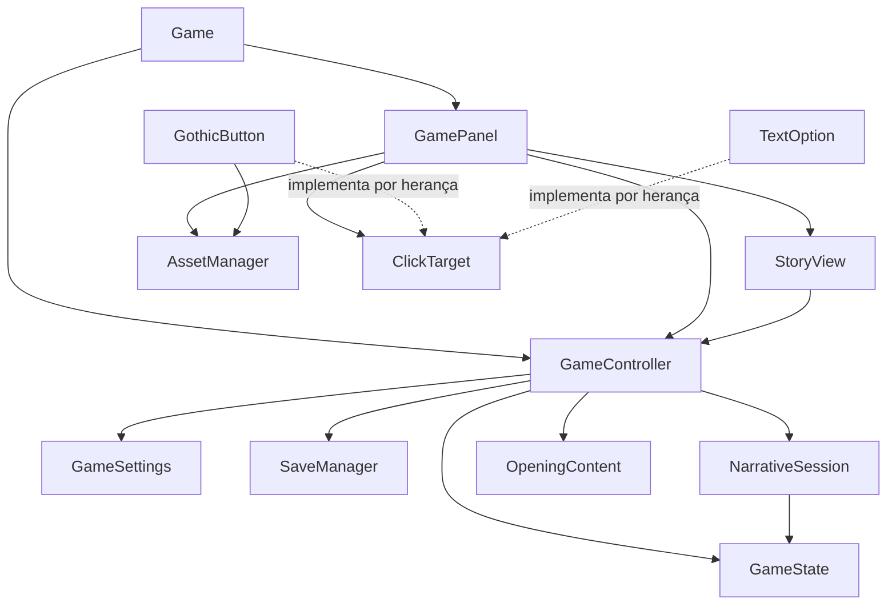
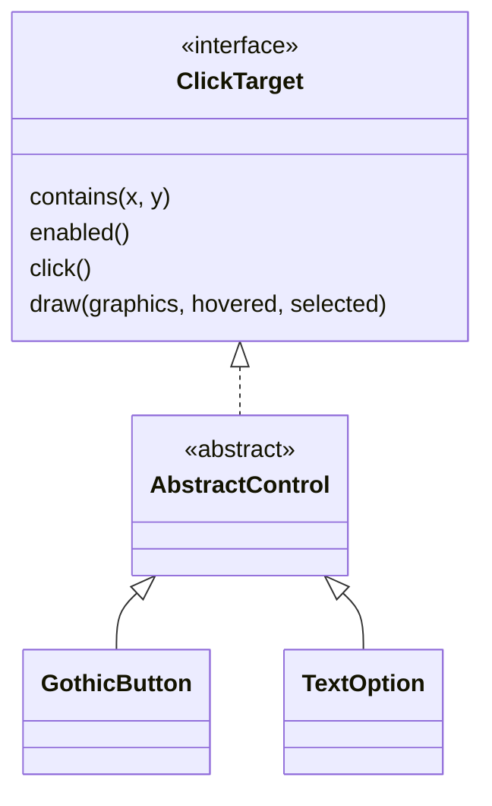

# Arquitetura e Programação Orientada a Objetos

Referência: 30/10/2026. Base: código Java atual e [planejamento do Capítulo I](planejamento-capitulo-01.md).

Este documento explica as responsabilidades existentes e orienta a expansão para a visual novel completa. **Classes futuras aparecem como planejadas; sua descrição não comprova implementação.** A referência narrativa é [rumos-da-historia.md](rumos-da-historia.md).

## 1. Escopo técnico

O projeto utiliza Java 21, Swing, Graphics2D e Maven, com imagens PNG e conteúdo narrativo em JSON. O fluxo é orientado a cliques em cenários estáticos, diálogos, escolhas e cutscenes. A arquitetura deve apoiar esse formato e a apresentação acadêmica dos quatro pilares de POO.

A expansão parte das classes atuais. Não é necessário substituir a aplicação, introduzir uma engine ou criar uma classe para cada fala, expressão ou página. O conteúdo fica nos dados; as classes representam estado, contratos e comportamentos.

## 2. Arquitetura existente

O pacote principal é `br.com.bibliotecadasalmas`.

| Classe ou contrato | Responsabilidade observada |
| --- | --- |
| [Game](../src/main/java/br/com/bibliotecadasalmas/Game.java) | Inicializa a janela e o controlador, configura tela cheia e oferece geração de preview. A janela é iniciada pela thread de eventos do Swing. |
| [GameController](../src/main/java/br/com/bibliotecadasalmas/core/GameController.java) | Coordena modos do protótipo, página do prólogo, inspeção de livro, início e continuação de partida e preferências. |
| [GameState](../src/main/java/br/com/bibliotecadasalmas/core/GameState.java) | Mantém progresso narrativo em memória: cursor imutável de cena/nó, local, inventário, memórias, flags, valores, escolhas e interações concluídas. Novo Jogo reinicia a mesma instância. |
| [GameMode](../src/main/java/br/com/bibliotecadasalmas/core/GameMode.java) | Enumera os modos de tela atuais; não representa sozinho os seis ambientes ou as cenas do roteiro. |
| [GameSettings](../src/main/java/br/com/bibliotecadasalmas/core/GameSettings.java) | Mantém preferências de efeitos, velocidade do texto e tela cheia, com métodos controlados. |
| [SaveManager](../src/main/java/br/com/bibliotecadasalmas/core/SaveManager.java) | Mantém preferências/saves legados em `.properties` e grava `historia.json` por temporário. O diretório é injetável para isolamento dos testes. |
| [StoryProgress](../src/main/java/br/com/bibliotecadasalmas/core/StoryProgress.java) | DTO versionado do save; reconstrói e valida um candidato de estado sem desserializar diretamente os campos privados de `GameState`. |
| [GamePanel](../src/main/java/br/com/bibliotecadasalmas/ui/GamePanel.java) | Renderiza telas, compõe a UI, transforma coordenadas e trata entradas de mouse e teclado. Ainda contém o texto fixo do prólogo demonstrativo. |
| [AssetManager](../src/main/java/br/com/bibliotecadasalmas/assets/AssetManager.java) | Carrega imagens sob `/assets/` pelo classpath e mantém cache por caminho. |
| [StoryLoader](../src/main/java/br/com/bibliotecadasalmas/narrative/StoryLoader.java) | Lê UTF-8 do classpath, de arquivo ou de `Reader`, usando Gson em modo estrito e modelos tipados. Não executa o fluxo carregado. |
| [StoryValidator](../src/main/java/br/com/bibliotecadasalmas/narrative/StoryValidator.java) | Valida IDs, destinos, parâmetros referenciados, contagens, ciclos automáticos e as três declarações da regra secreta. |
| [Story](../src/main/java/br/com/bibliotecadasalmas/narrative/Story.java) e modelos de `narrative/` | Records e contratos selados imutáveis para cenas, nós, escolhas, destinos, condições e efeitos. `StoryCondition.matches` consulta `GameState` sem alterá-lo. |
| [NarrativeSession](../src/main/java/br/com/bibliotecadasalmas/narrative/NarrativeSession.java) | Executa nós, escolhas, confirmação/cancelamento e lotes de efeitos sobre cópias do estado; cenas concluídas e efeitos recebem marcas. |
| [OpeningContent](../src/main/java/br/com/bibliotecadasalmas/narrative/OpeningContent.java) | Carrega e confere a configuração parcial de fundos, retratos, hotspots, documentos e pausas das cenas 01–04. |
| [StoryView](../src/main/java/br/com/bibliotecadasalmas/ui/StoryView.java) | Desenha texto progressivo, expressões, escolhas e telas de consulta. Usa `ClickTarget` e um relógio injetável para testar a revelação de texto sem esperas. |
| [Interactable](../src/main/java/br/com/bibliotecadasalmas/world/Interactable.java) | Contrato já implementado por `Investigation` e `Passage`, acionado pelos hotspots. |
| [ClickTarget](../src/main/java/br/com/bibliotecadasalmas/ui/ClickTarget.java) | Define `contains`, `enabled`, `click` e `draw` para controles da interface. |
| [AbstractControl](../src/main/java/br/com/bibliotecadasalmas/ui/AbstractControl.java) | Implementa parte de `ClickTarget`, compartilhando geometria, rótulo e comando. A classe é abstrata. |
| [GothicButton](../src/main/java/br/com/bibliotecadasalmas/ui/GothicButton.java) | Desenha botões usando imagens do UI Kit e estados de habilitação, hover e seleção. |
| [TextOption](../src/main/java/br/com/bibliotecadasalmas/ui/TextOption.java) | Desenha outra forma de controle clicável, usada na demonstração de exploração. |

Fluxo resumido de dependências existentes:

O controlador não depende de `Graphics2D`. Novo Jogo usa o consolidado nas cenas 01–04; `GamePanel` delega sua apresentação a `StoryView`. O texto fixo do prólogo em `GamePanel` permanece apenas para saves legados. O modo `STORY` separa o trecho novo de `INTRO` e `EXPLORACAO` antigos. A abertura integrada não equivale ao capítulo inteiro.

## 3. Os quatro pilares no código atual

### Encapsulamento

`GameSettings` mantém seus atributos privados e oferece operações como `toggleEffects`, `cycleTextSpeed` e `setFullscreen`. O carregamento limita a velocidade ao intervalo válido. O restante da aplicação usa esses métodos em vez de alterar campos diretamente.

`GameController` protege modo, página e estado de inspeção e controla suas mudanças. `SaveManager` concentra os detalhes dos arquivos de progresso. Esses exemplos mostram encapsulamento de estado e responsabilidade; apenas usar `private`, sem controlar alterações, seria uma demonstração incompleta.

`GameState` acrescenta regras concretas: itens não se duplicam, memórias e flags correspondentes permanecem sincronizadas, e uma navegação só é permitida após desbloquear o local. As consultas devolvem cópias imutáveis. O carregador valida as referências disponíveis no consolidado e `OpeningContent` confere a configuração parcial; os catálogos completos continuam pendentes.

### Abstração

`ClickTarget` descreve o que um controle clicável deve oferecer. `GamePanel` mantém uma coleção desse contrato e usa suas operações sem precisar reproduzir o desenho ou a lógica interna de cada controle.

A classe abstrata `AbstractControl` oferece uma implementação parcial. Contratos e classes abstratas têm papéis complementares: o primeiro descreve operações; a segunda compartilha estrutura e comportamento quando há uma relação de especialização.

### Herança

`GothicButton` e `TextOption` estendem `AbstractControl`. Reutilizam a verificação de limites, o estado de habilitação e o acionamento do comando, enquanto definem sua apresentação.

A relação existente é:

Os campos `bounds`, `label` e `command` são protegidos na superclasse. Esse acesso é parte do desenho atual; não afirmar na apresentação que todos os atributos de todas as classes são privados.

### Polimorfismo

`GamePanel` chama `draw` sobre elementos de uma coleção de `ClickTarget`. Um `GothicButton` usa texturas, enquanto `TextOption` desenha sua própria caixa. A mesma chamada resolve comportamentos diferentes conforme o objeto concreto.

Esse é o exemplo principal a demonstrar. O `switch` sobre `GameMode` controla telas, mas não é a evidência de polimorfismo dos controles.

## 4. Implementação Completa do Capítulo

Todas as classes planejadas foram plenamente implementadas e integradas no pacote principal `br.com.bibliotecadasalmas`. O sistema atende integralmente ao escopo dos quatro atos e três finais:

| Área e Pacote | Classes Concretas Implementadas | Responsabilidade Entregue |
| --- | --- | --- |
| `core/GameState` | `GameState.java` | Estado puro em memória: cursor de cena/nó, inventário, memórias, flags, escolhas, locais desbloqueados e verificação estrita dos 5 requisitos de reescrita (`canRewritePact`). |
| `core/GameController` | `GameController.java` | Orquestração de modos de jogo, navegação, investigação, suspensão e retomada de exploração aberta na cena 20. |
| `core/SaveManager` | `SaveManager.java`, `StoryProgress.java` | Gravação atômica (.tmp -> .json), restauração íntegra de ambiente, nós, escolhas pendentes e inventário sem corrupção. |
| `characters/` | `GameCharacter.java`, `Natasha.java`, `Rodion.java`, `Fantasma.java`, `Escriba.java`, `CharacterRegistry.java` | Hierarquia de herança e resolução polimórfica de retratos e nomes de exibição. Suporta anonimato (Rodion na cena 04), pseudônimos de memória e ocultação de rosto sem feições do Escriba. |
| `world/` | `Interactable.java` | Contrato abstrato e implementações concretas `Investigation` e `Passage`, despachadas polimorficamente por cliques em hotspots nos 6 ambientes. |
| `narrative/` | `StoryLoader.java`, `StoryValidator.java`, `Story.java`, `NarrativeNode.java`, `NarrativeSession.java`, `NarrativeEffect.java`, `StoryCondition.java`, `ChoiceOption.java`, `OpeningContent.java`, `StrictJson.java` | Motor narrativo data-driven baseado em tipos selados e records imutáveis. Validação estrita Gson de 28 cenas e 620 nós. |
| `ui/` | `GamePanel.java`, `StoryView.java`, `ClickTarget.java`, `AbstractControl.java`, `GothicButton.java`, `HotspotControl.java`, `TextOption.java` | Apresentação em Swing/Graphics2D com redimensionamento de alta qualidade, revelação progressiva, suporte a tela cheia (F11), confirmação modal e overlays de inventário/diário. |

Uma cena narrativa é uma sequência de nós; um ambiente é um lugar explorável. Várias cenas podem ocorrer no mesmo ambiente, e um epílogo pode mudar de fundo durante sua execução. Essa distinção evita usar uma única classe ou enumeração para conceitos diferentes.

### Fluxo de interação já utilizado na abertura

1. A interface transforma o clique em coordenadas lógicas e verifica se há uma apresentação modal ativa.
2. Na exploração, identifica um hotspot habilitado e aciona seu `Interactable`.
3. A implementação concreta pede navegação, investigação ou início de conversa.
4. O sistema narrativo avalia requisitos e processa os efeitos permitidos sobre `GameState`.
5. A interface apresenta o novo estado; o salvamento registra um ponto coerente de retomada.

Uma porta, um documento e um personagem devem responder à mesma operação de interação com resultados diferentes. Isso oferece uma demonstração de polimorfismo ligada ao mundo do jogo, além do exemplo já existente na UI.

## 5. Regras de separação e consistência

- `GamePanel` não deve escolher o final, conceder memórias por desenho de tela ou interpretar diretamente campos JSON a cada frame.
- O controlador coordena sistemas; evita concentrar todos os efeitos e diálogos em condicionais de uma única classe.
- `GameState` protege suas coleções. Consultas não devem permitir inserir itens ou flags sem validação.
- O interpretador conhece tipos de nó e contratos de efeito. Textos, opções e referências visuais vêm dos dados.
- Atualizar uma memória e sua flag correspondente faz parte da mesma alteração consistente de estado.
- Desbloquear um local e navegar até ele são operações diferentes.
- A elegibilidade da reescrita deve usar exatamente as cinco condições oficiais. Não criar requisitos ocultos nas subclasses dos personagens.
- Recarregar uma imagem ou redesenhar a tela não pode reaplicar efeitos narrativos.

A representação dos nós usa records que implementam `NarrativeNode`, com um tipo para cada comportamento. `StoryCondition.Flag` e `All` implementam `matches` de formas diferentes. `NarrativeSession` executa os efeitos tipados sobre `GameState.copy()` e publica o candidato validado por `replaceWith`. Isso mantém os lotes consistentes sem colocar falas ou efeitos no desenho da tela.

Gson 2.13.2 é a única dependência direta acrescentada para leitura JSON. O Maven Shade inclui as dependências no artefato executável, preservando `Game` como classe principal. O roteiro consolidado é um recurso do classpath; não há cópia operacional na raiz.

As regras detalhadas de escolhas, revisitas e aplicação de efeitos estão no [contrato narrativo](contrato-narrativo-json.md).

## 6. Swing, coordenadas e recursos

A interface usa uma área lógica de 1280 × 720, escalada proporcionalmente e centralizada. A transformação aplicada ao desenho precisa ser invertida para interpretar cliques; preservar essa correspondência ao acrescentar hotspots.

Eventos e alterações de apresentação devem respeitar a thread de eventos do Swing. Leitura de grandes pacotes não deve travar essa thread; carregar antecipadamente ou preparar recursos fora dela, publicando os resultados de forma controlada. Evitar acrescentar threads sem necessidade.

`AssetManager.get` recebe caminhos relativos a `/assets/`, por exemplo `menu/salao_principal.png`. O manifesto futuro deve resolver IDs narrativos para esses caminhos, sem depender de diretórios externos após empacotar o JAR. Transparência, proporção e conteúdo das imagens precisam ser conferidos, além da simples existência do arquivo.

## 7. Persistência e testes

O save narrativo da abertura usa `StoryProgress`, formato 1, em `historia.json`. Registra cursor, ambiente, fase ativa, confirmação, escolhas, flags, valores, inventário, memórias e marcas. Os formatos antigos em `.properties` permanecem compatíveis no fluxo legado. O contexto de exploração da cena 20 ainda está fora da interface e do save liberado.

`GameController.state()` mantém a mesma instância durante Novo Jogo e Continuação. O controlador cria o estado pelo ponto inicial carregado, reinicia preferências apenas quando solicitado e restaura um candidato validado por `StoryProgress`. `NarrativeSession.restore` não executa efeitos e recusa nós automáticos ativos em saves. A UI volta a revelar a fala retomada, sem repetir recompensas.

Salvar deve capturar conjuntamente os efeitos já aplicados e a posição de retomada. Ao continuar, restaurar esse estado sem conceder novamente itens ou executar eventos anteriores. Preferências permanecem separadas da progressão reiniciada por Novo Jogo.

O construtor de `SaveManager` que recebe `Path` já permite usar uma pasta temporária. `MenuSmokeTest` utiliza essa possibilidade e gera imagens do protótipo. Os novos testes devem preservar esse isolamento.

`GameStateTest`, também executado por `main`, verifica as regras do estado, suas coleções protegidas, o reinício por Novo Jogo e as 32 combinações das cinco condições secretas. Isso não substitui a validação da regra lida do JSON ou de uma partida completa.

O plano de execução e os resultados devem ser registrados em [testes-do-capitulo.md](testes-do-capitulo.md). Este documento não comprova que os testes foram executados.

## 8. Roteiro para a apresentação acadêmica

A demonstração completa do Capítulo I e dos pilares de POO está detalhada no [Relatório Acadêmico de POO](relatorio-academico-poo.md):

1. **Encapsulamento:** Mostrar os campos privados de `GameState`, suas coleções imutáveis para consulta (`Collections.unmodifiableSet`), a sincronização atômica de memória/flag (`syncFlagForMemory`), o método de regra canônica `canRewritePact()` e a persistência atômica segura em `SaveManager` / `StoryProgress`.
2. **Abstração:** Abrir os contratos `ClickTarget` (UI), `Interactable` (mundo), `GameCharacter` (personagens) e os tipos selados `NarrativeNode` e `NarrativeEffect`.
3. **Herança:** Mostrar `AbstractControl` e suas subclasses (`GothicButton`, `HotspotControl`, `TextOption`), bem como `GameCharacter` e suas especializações (`Natasha`, `Rodion`, `Fantasma`, `Escriba`).
4. **Polimorfismo:** Demonstrar o despacho polimórfico de `ClickTarget.draw()` no `GamePanel`, a execução de `Interactable.interact()` (investigação vs passagem), a resolução de nomes e retratos em `CharacterRegistry` e a avaliação exaustiva de nós e efeitos em `NarrativeSession`.
5. **Roteiro de Demonstração Completo:** Seguir o roteiro passo a passo do [Relatório Acadêmico](relatorio-academico-poo.md#4-guia-de-demonstração-acadêmica-roteiro-para-apresentação-em-banca), percorrendo do menu inicial aos três desfechos finais do capítulo.

Commit sugerido: `docs: documenta arquitetura e exemplos dos pilares de poo`.
