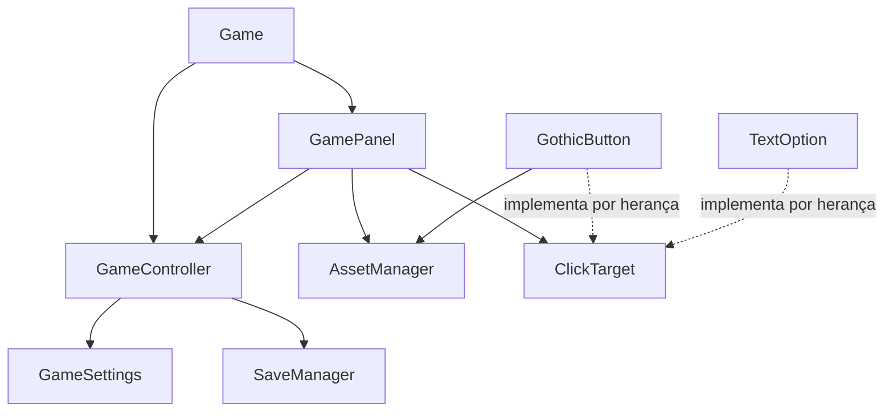
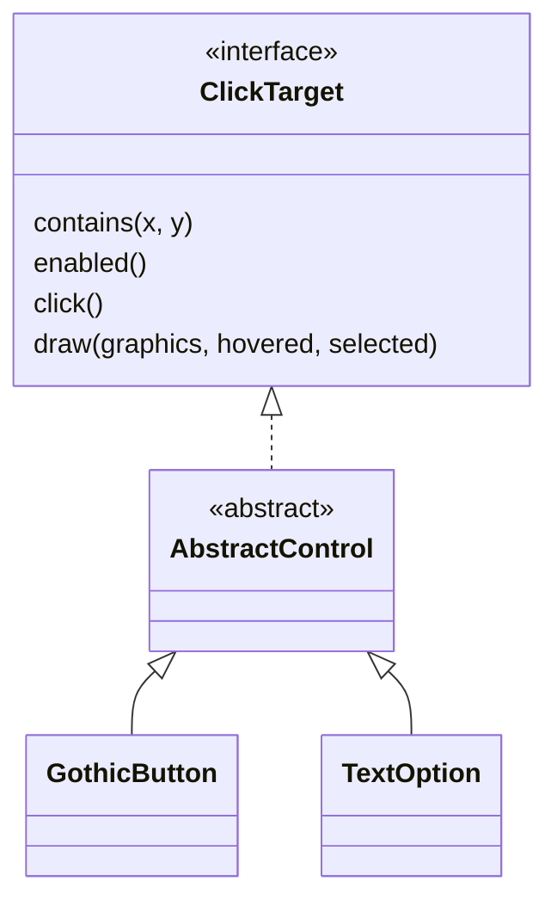

# Arquitetura e Programação Orientada a Objetos

Referência: 30/10/2026. Base: código Java atual e [planejamento do Capítulo I](planejamento-capitulo-01.md).

Este documento explica as responsabilidades existentes e orienta a expansão para a visual novel completa. **Classes futuras aparecem como planejadas; sua descrição não comprova implementação.** A referência narrativa é [rumos-da-historia.md](rumos-da-historia.md).

## 1. Escopo técnico

O projeto utiliza Java 21, Swing, Graphics2D e Maven, com imagens PNG e conteúdo narrativo em JSON. O fluxo é orientado a cliques em cenários estáticos, diálogos, escolhas e cutscenes. A arquitetura deve apoiar esse formato e a apresentação acadêmica dos quatro pilares de POO.

A expansão parte das classes atuais. Não é necessário substituir a aplicação, introduzir uma engine ou criar uma classe para cada fala, expressão ou página. O conteúdo fica nos dados; as classes representam estado, contratos e comportamentos.

## 2. Arquitetura existente

O pacote principal é `br.com.bibliotecadasalmas`.

| Classe ou contrato | Responsabilidade observada |
| --- | --- |
| [Game](../src/main/java/br/com/bibliotecadasalmas/Game.java) | Inicializa a janela e o controlador, configura tela cheia e oferece geração de preview. A janela é iniciada pela thread de eventos do Swing. |
| [GameController](../src/main/java/br/com/bibliotecadasalmas/core/GameController.java) | Coordena modos do protótipo, página do prólogo, inspeção de livro, início e continuação de partida e preferências. |
| [GameMode](../src/main/java/br/com/bibliotecadasalmas/core/GameMode.java) | Enumera os modos de tela atuais; não representa sozinho os seis ambientes ou as cenas do roteiro. |
| [GameSettings](../src/main/java/br/com/bibliotecadasalmas/core/GameSettings.java) | Mantém preferências de efeitos, velocidade do texto e tela cheia, com métodos controlados. |
| [SaveManager](../src/main/java/br/com/bibliotecadasalmas/core/SaveManager.java) | Lê e grava preferências e progresso básico em `.properties`. Aceita um diretório no construtor, permitindo isolamento nos testes. |
| [GamePanel](../src/main/java/br/com/bibliotecadasalmas/ui/GamePanel.java) | Renderiza telas, compõe a UI, transforma coordenadas e trata entradas de mouse e teclado. Ainda contém o texto fixo do prólogo demonstrativo. |
| [AssetManager](../src/main/java/br/com/bibliotecadasalmas/assets/AssetManager.java) | Carrega imagens sob `/assets/` pelo classpath e mantém cache por caminho. |
| [ClickTarget](../src/main/java/br/com/bibliotecadasalmas/ui/ClickTarget.java) | Define `contains`, `enabled`, `click` e `draw` para controles da interface. |
| [AbstractControl](../src/main/java/br/com/bibliotecadasalmas/ui/AbstractControl.java) | Implementa parte de `ClickTarget`, compartilhando geometria, rótulo e comando. A classe é abstrata. |
| [GothicButton](../src/main/java/br/com/bibliotecadasalmas/ui/GothicButton.java) | Desenha botões usando imagens do UI Kit e estados de habilitação, hover e seleção. |
| [TextOption](../src/main/java/br/com/bibliotecadasalmas/ui/TextOption.java) | Desenha outra forma de controle clicável, usada na demonstração de exploração. |

Fluxo resumido de dependências existentes:

O controlador não depende de `Graphics2D`. Entretanto, a separação da história ainda está incompleta: `GamePanel` contém falas do prólogo, e não há um interpretador do roteiro JSON. A demonstração atual não deve ser apresentada como arquitetura final do capítulo.

## 3. Os quatro pilares no código atual

### Encapsulamento

`GameSettings` mantém seus atributos privados e oferece operações como `toggleEffects`, `cycleTextSpeed` e `setFullscreen`. O carregamento limita a velocidade ao intervalo válido. O restante da aplicação usa esses métodos em vez de alterar campos diretamente.

`GameController` protege modo, página e estado de inspeção e controla suas mudanças. `SaveManager` concentra os detalhes dos arquivos de progresso. Esses exemplos mostram encapsulamento de estado e responsabilidade; apenas usar `private`, sem controlar alterações, seria uma demonstração incompleta.

### Abstração

`ClickTarget` descreve o que um controle clicável deve oferecer. `GamePanel` mantém uma coleção desse contrato e usa suas operações sem precisar reproduzir o desenho ou a lógica interna de cada controle.

A classe abstrata `AbstractControl` oferece uma implementação parcial. Contratos e classes abstratas têm papéis complementares: o primeiro descreve operações; a segunda compartilha estrutura e comportamento quando há uma relação de especialização.

### Herança

`GothicButton` e `TextOption` estendem `AbstractControl`. Reutilizam a verificação de limites, o estado de habilitação e o acionamento do comando, enquanto definem sua apresentação.

A relação existente é:

Os campos `bounds`, `label` e `command` são protegidos na superclasse. Esse acesso é parte do desenho atual; não afirmar na apresentação que todos os atributos de todas as classes são privados.

### Polimorfismo

`GamePanel` chama `draw` sobre elementos de uma coleção de `ClickTarget`. Um `GothicButton` usa texturas, enquanto `TextOption` desenha sua própria caixa. A mesma chamada resolve comportamentos diferentes conforme o objeto concreto.

Esse é o exemplo principal a demonstrar. O `switch` sobre `GameMode` controla telas, mas não é a evidência de polimorfismo dos controles.

## 4. Expansão planejada para o capítulo

A tabela abaixo apresenta responsabilidades propostas. Exceto pelas classes identificadas como existentes, os nomes são orientações de implementação, não arquivos já criados.

| Área | Responsabilidade planejada |
| --- | --- |
| `core/GameState` | Guardar cenário, cursor narrativo, flags, escolhas, inventário, memórias, locais liberados e interações concluídas. |
| `narrative/` | Carregar e validar dados; avaliar condições; executar nós e efeitos; fornecer falas e escolhas à interface. Os nomes internos das classes podem ser definidos durante a implementação. |
| `characters/GameCharacter` | Classe abstrata de personagem, com identidade e apresentação compartilhadas e operações pertinentes ao domínio. |
| `characters/Natasha`, `Rodion`, `Fantasma`, `Escriba` | Especializar a base, mantendo as regras e apresentações próprias sem copiar a lógica comum. Não transferir o roteiro inteiro para essas classes. |
| `world/Interactable` | Contrato de interação com objetos do mundo. |
| `world/` | Representar ambientes, hotspots, portas, documentos e interlocutores, com disponibilidade definida pelo estado. |
| `ui/` existente | Apresentar o estado, diálogos, escolhas, inventário e diário; encaminhar ações do jogador. |
| `assets/` existente | Resolver imagens e seu cache, integrado ao manifesto de recursos. |
| `core/SaveManager` existente | Evoluir para persistir o estado narrativo e tratar versões de save, sem assumir o papel do interpretador. |

Uma cena narrativa é uma sequência de nós; um ambiente é um lugar explorável. Várias cenas podem ocorrer no mesmo ambiente, e um epílogo pode mudar de fundo durante sua execução. Essa distinção evita usar uma única classe ou enumeração para conceitos diferentes.

### Fluxo planejado de interação

1. A interface transforma o clique em coordenadas lógicas e verifica se há uma apresentação modal ativa.
2. Na exploração, identifica um hotspot habilitado e aciona seu `Interactable`.
3. A implementação concreta pede navegação, investigação ou início de conversa.
4. O sistema narrativo avalia requisitos e processa os efeitos permitidos sobre `GameState`.
5. A interface apresenta o novo estado; o salvamento registra um ponto coerente de retomada.

Uma porta, um documento e um personagem devem responder à mesma operação de interação com resultados diferentes. Isso oferece uma demonstração de polimorfismo ligada ao mundo do jogo, além do exemplo já existente na UI.

## 5. Regras de separação e consistência

- `GamePanel` não deve escolher o final, conceder memórias por desenho de tela ou interpretar diretamente campos JSON a cada frame.
- O controlador coordena sistemas; evita concentrar todos os efeitos e diálogos em condicionais de uma única classe.
- `GameState` protege suas coleções. Consultas não devem permitir inserir itens ou flags sem validação.
- O interpretador conhece tipos de nó e contratos de efeito. Textos, opções e referências visuais vêm dos dados.
- Atualizar uma memória e sua flag correspondente faz parte da mesma alteração consistente de estado.
- Desbloquear um local e navegar até ele são operações diferentes.
- A elegibilidade da reescrita deve usar exatamente as cinco condições oficiais. Não criar requisitos ocultos nas subclasses dos personagens.
- Recarregar uma imagem ou redesenhar a tela não pode reaplicar efeitos narrativos.

A representação dos nós pode usar classes, records ou outra estrutura simples e tipada. Não é obrigatório construir uma hierarquia extensa só para demonstrar POO. A leitura JSON deve usar uma solução justificada, sem bibliotecas de jogo alheias ao escopo.

As regras detalhadas de escolhas, revisitas e aplicação de efeitos estão no [contrato narrativo](contrato-narrativo-json.md).

## 6. Swing, coordenadas e recursos

A interface usa uma área lógica de 1280 × 720, escalada proporcionalmente e centralizada. A transformação aplicada ao desenho precisa ser invertida para interpretar cliques; preservar essa correspondência ao acrescentar hotspots.

Eventos e alterações de apresentação devem respeitar a thread de eventos do Swing. Leitura de grandes pacotes não deve travar essa thread; carregar antecipadamente ou preparar recursos fora dela, publicando os resultados de forma controlada. Evitar acrescentar threads sem necessidade.

`AssetManager.get` recebe caminhos relativos a `/assets/`, por exemplo `menu/salao_principal.png`. O manifesto futuro deve resolver IDs narrativos para esses caminhos, sem depender de diretórios externos após empacotar o JAR. Transparência, proporção e conteúdo das imagens precisam ser conferidos, além da simples existência do arquivo.

## 7. Persistência e testes

O save atual contém modo e página do prólogo. O save completo deverá incluir cursor, mundo, escolhas, inventário, memórias e contexto de exploração suspenso. Definir versão e compatibilidade antes de substituir o formato atual.

Salvar deve capturar conjuntamente os efeitos já aplicados e a posição de retomada. Ao continuar, restaurar esse estado sem conceder novamente itens ou executar eventos anteriores. Preferências permanecem separadas da progressão reiniciada por Novo Jogo.

O construtor de `SaveManager` que recebe `Path` já permite usar uma pasta temporária. `MenuSmokeTest` utiliza essa possibilidade e gera imagens do protótipo. Os novos testes devem preservar esse isolamento.

O plano de execução e os resultados devem ser registrados em [testes-do-capitulo.md](testes-do-capitulo.md). Este documento não comprova que os testes foram executados.

## 8. Roteiro para a apresentação acadêmica

A demonstração atual pode usar estes passos:

1. Mostrar os campos privados e métodos controlados de `GameSettings` e `GameController` para explicar encapsulamento.
2. Abrir `ClickTarget` para explicar o contrato de interação e desenho.
3. Mostrar `AbstractControl` e suas subclasses para explicar herança e reutilização.
4. Mostrar a coleção de `ClickTarget` e as duas implementações de `draw` para explicar polimorfismo.
5. Exibir o menu e a inspeção do livro para relacionar as classes à interface do protótipo.

Depois da integração, acrescentar evidências de `GameState`, da hierarquia dos quatro personagens e de implementações diferentes de `Interactable`. Demonstrar uma investigação que atualiza memória e inventário e uma porta que navega usando o mesmo contrato.

Atualizar os exemplos conforme o código evoluir. Uma classe planejada, um diagrama ou uma assinatura sem comportamento não substitui a demonstração de uma funcionalidade implementada.

Commit sugerido: `docs: documenta arquitetura e exemplos dos pilares de poo`.
