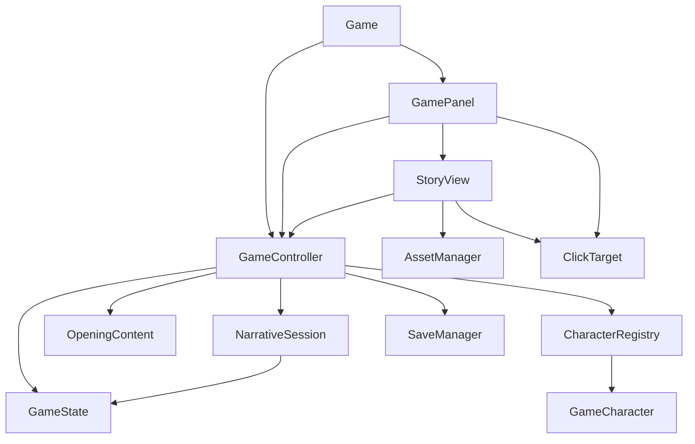
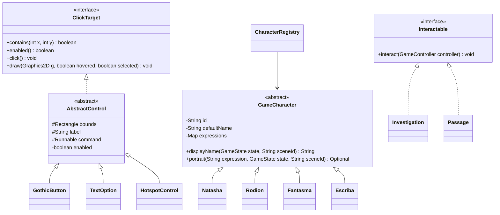

# Arquitetura e Programação Orientada a Objetos

Referência: **11/11/2026**, commit `389433f`. Este documento descreve as classes existentes. A situação dos requisitos do professor está na [documentação acadêmica](documentacao-academica.md); as evidências estão em [Testes do capítulo](testes-do-capitulo.md).

## 1. Escopo e camadas

O projeto utiliza Java 21, Swing, Graphics2D, Maven e Gson 2.13.2. O consolidado contém 28 entradas de cena e 620 nós; `trecho_inicial.json`, cujo nome foi preservado, configura os quatro atos e os epílogos. Os seis ambientes são distintos na lógica; quatro deles ainda reutilizam o fundo do Salão.

| Classe ou contrato | Responsabilidade existente |
| --- | --- |
| [Game](../src/main/java/br/com/bibliotecadasalmas/Game.java) | Inicializa a janela na EDT, configura F11 e oferece `--validate-story` e `--preview`. |
| [GameController](../src/main/java/br/com/bibliotecadasalmas/core/GameController.java) | Coordena telas, exploração, sessão, consultas, personagens e checkpoints. |
| [GameState](../src/main/java/br/com/bibliotecadasalmas/core/GameState.java) | Protege local, posição narrativa, itens, memórias, flags, valores textuais, escolhas e marcas. |
| GameMode / GameSettings | Separam modo da interface e preferências de exibição. |
| [StoryLoader](../src/main/java/br/com/bibliotecadasalmas/narrative/StoryLoader.java) / StoryValidator | Constroem modelos imutáveis a partir de JSON estrito e validam referências e regras. |
| [NarrativeSession](../src/main/java/br/com/bibliotecadasalmas/narrative/NarrativeSession.java) | Executa nós, escolhas, condições, confirmações e lotes de efeitos. |
| [OpeningContent](../src/main/java/br/com/bibliotecadasalmas/narrative/OpeningContent.java) | Carrega seis locais, 28 saídas de cena, 12 cutscenes, oito documentos e pausas da exploração. |
| GamePanel / [StoryView](../src/main/java/br/com/bibliotecadasalmas/ui/StoryView.java) | Transformam coordenadas, desenham o estado e encaminham entradas. |
| [GameCharacter](../src/main/java/br/com/bibliotecadasalmas/characters/GameCharacter.java) | Compartilha identidade e mapa imutável de expressões entre os quatro personagens. |
| [CharacterRegistry](../src/main/java/br/com/bibliotecadasalmas/characters/CharacterRegistry.java) | Registra personagens e resolve nome/retrato, incluindo aliases de memória e voz. |
| Interactable | Contrato selado implementado pelos records `Investigation` e `Passage`. |
| ClickTarget / AbstractControl | Contrato e implementação parcial de geometria, habilitação e clique dos controles. |
| GothicButton / TextOption / HotspotControl | Especializam desenho e, no hotspot, a consulta aos limites do rótulo. |
| AssetManager | Carrega imagens do classpath sob demanda e mantém cache por caminho. |
| SaveManager / StoryProgress | Persistem preferências, saves legados e o progresso narrativo versionado. |

O controlador não depende de Graphics2D. A narrativa atual vem dos dados; o texto fixo de prólogo em `GamePanel` permanece no fluxo legado para saves antigos.

## 2. Encapsulamento

`GameState` usa campos privados e consultas com cópias imutáveis. `giveItem` evita duplicação por meio de um conjunto; `unlockMemory` chama `setFlag`, mantendo memória e flag correspondentes sincronizadas. `moveToLocation` recusa um destino bloqueado. `canRewritePact` exige exatamente as três memórias, confiança da Fantasma e descoberta da cláusula.

`GameCharacter` protege `id`, `defaultName` e `expressions`. O mapa de expressões é copiado e tornado não modificável no construtor. Seus acessores são `id()`, `defaultName()` e `expressions()`.

Nem todos os campos são privados ou finais: `AbstractControl` compartilha `bounds`, `label` e `command` como `protected final`; seu campo `enabled` é privado. Local e cursor em `GameState` são alteráveis por operações controladas.

## 3. Abstração, herança e polimorfismo

`List<ClickTarget>` permite desenhar controles diferentes pela chamada `draw`. `Interactable.interact` permite investigar uma cena ou atravessar uma passagem pela mesma operação.

`CharacterRegistry` mantém `Map<String, GameCharacter>`. Os métodos `displayName(state, sceneId)` e `portrait(expression, state, sceneId)` têm implementação na classe abstrata; não são declarados abstratos. `Rodion` os sobrescreve: na cena 04, o nome é “Uma voz” e o retrato é ausente; nas demais cenas, usa a identidade padrão.

`Natasha`, `Fantasma` e `Escriba` configuram identidade e expressões pelos construtores. O Escriba possui retratos: o rosto sem feições é uma característica da arte. O alias `voz_escriba` fica sem retrato. Os aliases de memória recebem nomes específicos no registro e reutilizam o personagem correspondente para resolver a imagem.

O despacho de métodos sobrescritos é o exemplo de polimorfismo. O `switch` com pattern matching em `NarrativeSession` é seleção por tipo e tratamento dos contratos selados, não equivale ao despacho virtual de `draw`.

## 4. Execução e apresentação

As ações passam por `GameController` e `NarrativeSession`. Efeitos são calculados sobre `GameState.copy()` e publicados por `replaceWith` após validação, com marcas de aplicação. O desenho não concede itens nem reaplica eventos.

A área lógica é 1280 × 720. `GamePanel` escala e centraliza a renderização e inverte a transformação para interpretar cliques. Um Timer pede redesenho a cada 33 ms. Isso não representa movimento de entidade ou garante uma taxa fixa de quadros.

Na apresentação de fala, `StoryView` desenha o retrato antes da caixa, centraliza o nome na faixa e coloca a indicação de clique dentro do diálogo. O retrato usa uma área lógica de 350 × 390, preservando a proporção. As cutscenes substituem o fundo durante seus nós.

`requireFlag` e `hideWhenFlag` controlam a disponibilidade de hotspots. Inventário e diário usam os oito documentos configurados, disponíveis conforme itens e memórias do estado.

## 5. Persistência e distribuição

`StoryProgress` é um record de formato 1 com roteiro/versão, local, cena/nó, sessão ativa, confirmação, flags, valores, escolhas, inventário, memórias, locais e marcas. Não há um campo independente para contexto de exploração suspensa; a revisita da cena 20 depende do cursor e das marcas configuradas.

`SaveManager` grava um temporário e solicita `ATOMIC_MOVE`; quando não suportado, usa substituição comum. Não se deve afirmar atomicidade incondicional em qualquer sistema de arquivos.

Continuar valida um candidato e restaura a sessão sem executar efeitos. A revelação da fala recomeça; consultas fecham. Preferências e saves legados usam `.properties`.

O JAR versionado é `dist/BibliotecaDasAlmas-Menu.jar`, gerenciado por Git LFS. O build Maven gera `target/biblioteca-das-almas-menu-1.0.0.jar`. Scripts priorizam o nome distribuído e aceitam o nome Maven como alternativa em `dist/`.

## 6. Limites e próximas adequações

Os testes dos quatro atos existem e os resultados atuais estão em [Testes do capítulo](testes-do-capitulo.md). Não há medição de cobertura de 100%.

Continuam pendentes os fundos específicos de Balcão, Corredor, Arquivo e Câmara, a conferência interativa de foco/tela cheia e as exigências acadêmicas de Esc imediato, movimento com setas/WASD/diagonais, colisão e áudio pré-carregado. A hierarquia `GameCharacter` não implementa a família `MyShape` do professor.

O [relatório de POO](relatorio-academico-poo.md) oferece os exemplos para a apresentação; o [planejamento](planejamento-capitulo-01.md) acompanha o trabalho restante.
