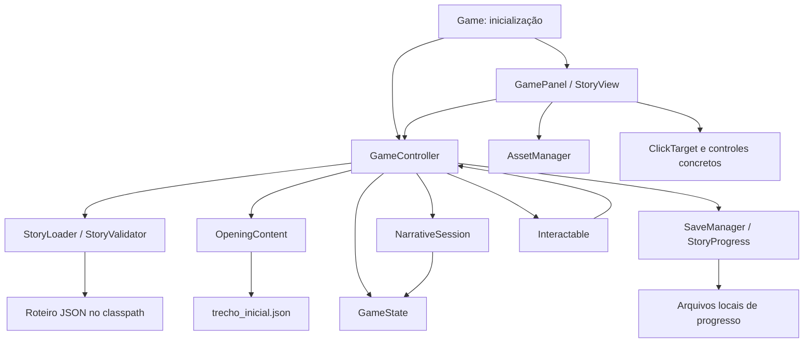
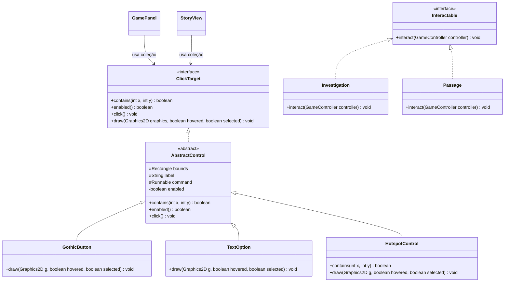

# A Biblioteca das Almas — Documentação do Trabalho Prático

**Programação Orientada a Objetos e Desenvolvimento de Jogos 2D**  
**Referência da documentação:** 10/11/2026  
**Base de código analisada:** commit `7a8c05e`

| Identificação | Informação |
| --- | --- |
| Instituição | UniSenai |
| Curso e turma | ADS - TADS2 |
| Disciplina | BackEnd |
| Professor | Cainã Antunes |
| Integrante 1 | Felipe Nunes Ramalho - 26154726  |
| Integrante 2 | Juliana Karla Camargo da Silva - 26154769 |
| Repositório Git/GitHub para entrega | https://github.com/FelipeNRamalho/a-biblioteca-das-almas-java.git |

## 1. Objetivo e referência acadêmica

Este documento apresenta o projeto **A Biblioteca das Almas**, sua arquitetura, os exemplos implementados dos quatro pilares de POO, os procedimentos de execução e a situação dos requisitos do trabalho prático.

A referência é o arquivo **Orientações-jg-em-dupla.md**, fornecido pelo professor e consultado na elaboração desta documentação. Suas orientações definem Java desktop, Swing/Graphics2D, demonstração de POO, tela cheia sem bordas, encerramento por Esc, movimento por setas e WASD com diagonais, imagens, áudio pré-carregado, colisões, versionamento e documentação Markdown com Mermaid.

O projeto atual é uma aventura narrativa com exploração por cliques. Essa escolha explica sua organização, mas **não comprova dispensa dos requisitos de movimentação, colisão, áudio ou da hierarquia de referência do professor**. As diferenças estão registradas na seção 4 para adequação ou validação formal com o professor. Esta documentação descreve o código existente; não implementa os requisitos pendentes.

## 2. Apresentação do jogo

### 2.1 Proposta

**A Biblioteca das Almas** é um jogo 2D de mistério e fantasia gótica. A protagonista, Natasha Rostova, desperta diante de uma biblioteca sobrenatural sem recordar como chegou ali. A investigação de cartas, livros e outros registros revela a relação entre suas memórias e as histórias das almas preservadas no local.

A experiência combina cenas ilustradas, retratos de personagens, diálogos progressivos, escolhas, inventário e diário de memórias. O jogador interage com áreas clicáveis dos cenários, chamadas *hotspots*. O objetivo narrativo é compreender o passado de Natasha e decidir o destino dos registros.

### 2.2 Escopo implementado e planejado

| Parte | Situação observada |
| --- | --- |
| Menu inicial | Novo Jogo, Continuar, Configurações, Créditos e Sair disponíveis. |
| Abertura jogável | Cenas 01–04: despertar, carta, passagem pela porta e investigação do livro. |
| Ambientes exploráveis na abertura | Entrada da Biblioteca e Salão Principal, incluindo retorno para investigar a carta adiada. |
| Narrativa | Roteiro consolidado carregado e validado: 28 entradas de cena e 620 nós. A presença do capítulo no JSON não significa que todo ele esteja jogável. |
| Progresso | Inventário, Memória 1, escolhas, flags e retomada da abertura implementados. |
| Capítulo completo | Planejado com 26 cenas narrativas; as variações da cena final resultam nas 28 entradas do consolidado. Integração posterior à cena 04 pendente. |
| Personagens | Natasha tem retratos integrados. Rodion, Fantasma e Escriba fazem parte do roteiro; sua apresentação completa e hierarquia própria de classes permanecem planejadas. |
| Finais | Três finais previstos nos dados. A lógica das condições é verificável, mas os percursos completos ainda não estão disponíveis na interface. |

O ciclo jogável atual é: **explorar → investigar → ler → escolher → atualizar o progresso → salvar → continuar a exploração**.

## 3. Tecnologias e organização dos arquivos

| Tecnologia | Aplicação no projeto |
| --- | --- |
| Java 21 | Classes, regras, estado, contratos e execução desktop. |
| Swing | `JFrame`, `JPanel`, eventos e temporizador de redesenho. |
| Graphics2D | Desenho de cenários, retratos, textos e controles. |
| Maven | Compilação e empacotamento declarados em `pom.xml`. |
| Gson 2.13.2 | Leitura de dados JSON e suporte à persistência narrativa. |
| PNG | Fundos, retratos, escolhas e ornamentos da interface. |
| Git | Histórico de alterações do projeto. A URL de entrega no GitHub deve ser informada pela dupla. |
| Markdown e Mermaid | Documentação, arquitetura e relações entre classes. |

Não há motor gráfico externo. A Java Sound API é exigida pelas orientações, mas ainda não está implementada no projeto.

```text
a-biblioteca-das-almas-java/
├── pom.xml
├── README.md
├── INICIAR_WINDOWS.bat
├── INICIAR_LINUX_MAC.sh
├── dist/
│   └── BibliotecaDasAlmas-Menu.jar    # Distribuição anterior do protótipo
├── docs/
│   ├── documentacao-academica.md
│   ├── arquitetura-e-poo.md
│   ├── testes-do-capitulo.md
│   └── planejamento-capitulo-01.md
├── src/
│   ├── main/
│   │   ├── java/br/com/bibliotecadasalmas/
│   │   │   ├── Game.java
│   │   │   ├── assets/              # Carregamento e cache de imagens
│   │   │   ├── core/                # Controlador, estado e persistência
│   │   │   ├── narrative/           # Modelos, carregador e executor JSON
│   │   │   ├── ui/                  # Painel, apresentação e controles
│   │   │   └── world/               # Contrato das interações
│   │   └── resources/
│   │       ├── assets/              # Cenários, personagens, menu e UI
│   │       └── story/
│   │           ├── roteiro_completo.json
│   │           └── trecho_inicial.json
│   └── test/java/br/com/bibliotecadasalmas/
│       ├── StoryLoaderTest.java
│       ├── GameStateTest.java
│       ├── OpeningGameplayTest.java
│       └── MenuSmokeTest.java
└── target/                         # Saída de compilação; ignorada pelo Git
```

A organização usa as convenções Maven. `src/main/java` contém as classes e `src/main/resources` contém os recursos incorporados ao JAR. `target/classes` cumpre a função de saída de bytecodes que a referência atribui a `bin/`. Os pacotes `core`, `narrative`, `ui` e `world` distribuem responsabilidades que o exemplo concentra em `model` e `view`. Essa correspondência funcional não constitui confirmação de aceite da nomenclatura pelo professor.

## 4. Atendimento às orientações do professor

**Atendido** indica evidência no código; **parcial** indica implementação incompleta ou divergente; **pendente** indica ausência da implementação exigida; **a validar** indica dependência de conferência ou aceite externo.

| Requisito das orientações | Situação | Evidência e providência necessária |
| --- | --- | --- |
| Java desktop, Swing e Graphics2D | Atendido | `Game` cria a janela e `GamePanel`/`StoryView` desenham a interface. |
| Abstração, encapsulamento, herança e polimorfismo | Atendido nos exemplos atuais | `ClickTarget`, `AbstractControl`, subclasses, `GameState` e `Interactable`; exemplos na seção 6. |
| Hierarquia de referência `MyShape`, `MyRectangle`, `MySquare`, `MyEllipse`, `MyCircle` e `MyCharacter` | Pendente em relação à especificação | Essas classes não existem. A hierarquia da UI demonstra POO, mas não preserva a hierarquia oficial apresentada no guia. Adequar ou obter aceite explícito da adaptação. |
| Inicialização em tela cheia sem bordas ocupando o monitor | Parcial | Há alternância por F11 e `GraphicsDevice.setFullScreenWindow`. A preferência padrão é janela (`fullscreen = false`) e não há configuração explícita por `setUndecorated(true)`. A inicialização imersiva exigida não está garantida. |
| Esc encerra imediatamente | Pendente | Esc fecha consultas, cancela confirmação ou retorna ao menu. A saída é acionada pela opção Sair. |
| Movimento com quatro setas e WASD | Pendente | Cima/baixo selecionam controles. Não há deslocamento de entidade nem comandos WASD. |
| Movimento diagonal simultâneo | Pendente | Não há estado de teclas pressionadas para movimentação. |
| Carregamento e desenho de imagens/sprites | Atendido para imagens 2D | `AssetManager` carrega PNGs e os mantém em cache; cenários e retratos são desenhados por Graphics2D. Não há personagem com locomoção animada. |
| Áudio pré-carregado com Java Sound e `Clip` | Pendente | Não há carregamento de áudio, `Clip` ou efeitos sonoros integrados. A opção de efeitos nas configurações não comprova suporte a som. |
| Reinício do som sem reabrir o arquivo | Pendente | Ainda não existem `playSound()` nem `setFramePosition(0)` para esse fim. |
| Colisão por bounding box entre entidades | Pendente | Há teste de ponto dentro de retângulo para cliques, mas não `intersects(MyShape)` ou sistema de colisão entre entidades. |
| Laço reverso para remoção de entidades em listas | Sem caso implementado; regra pendente para a mecânica | A abertura não mantém uma lista de entidades coletáveis por colisão. Remoções de inventário usam `Set`. Não há demonstração do laço reverso exigido. |
| Pastas `src`, `bin`, `model`, `view`, `image` e `sound` | Parcial / a validar | `src` existe; a estrutura adota Maven, pacotes próprios e `assets`. Não há pacote de sons integrado. |
| Versionamento Git/GitHub | Parcial / a validar | Há histórico Git local. Confirmar acesso ao repositório remoto e preencher a URL de entrega. |
| Documentação Markdown e diagramas Mermaid | Atendido no repositório | Este documento inclui diagramas de arquitetura e classes, além dos documentos técnicos relacionados. |
| Compilar e executar em terminal e IDE | Parcialmente verificado | Fontes compiladas com JDK 21 e testes executáveis conferidos conforme seção 10. Execução interativa na IDE e tela cheia exigem conferência manual. |
| Domínio do código e das ferramentas auxiliares/IA | A validar pela dupla | Cada integrante deve explicar as classes, regras e recursos usados; registrar autoria e ferramentas efetivamente utilizadas. |

Não há registro, nos arquivos consultados, de autorização do professor para dispensar as exigências divergentes. A documentação não declara o projeto integralmente conforme enquanto esses pontos estiverem abertos.

## 5. Arquitetura e responsabilidades

| Classe ou grupo | Responsabilidade |
| --- | --- |
| [Game](../src/main/java/br/com/bibliotecadasalmas/Game.java) | Ponto de entrada, criação da janela na thread de eventos do Swing, F11 e validação de roteiro por argumento. |
| [GameController](../src/main/java/br/com/bibliotecadasalmas/core/GameController.java) | Coordena telas, ações narrativas, interações, consultas e checkpoints de salvamento. |
| [GameState](../src/main/java/br/com/bibliotecadasalmas/core/GameState.java) | Mantém e protege local, cursor narrativo, inventário, memórias, escolhas e flags. |
| [StoryLoader](../src/main/java/br/com/bibliotecadasalmas/narrative/StoryLoader.java) / [StoryValidator](../src/main/java/br/com/bibliotecadasalmas/narrative/StoryValidator.java) | Carregam JSON estrito, constroem modelos e validam referências e regras. |
| [NarrativeSession](../src/main/java/br/com/bibliotecadasalmas/narrative/NarrativeSession.java) | Executa nós, escolhas, condições e efeitos sobre o estado da partida. |
| [OpeningContent](../src/main/java/br/com/bibliotecadasalmas/narrative/OpeningContent.java) | Carrega a configuração parcial das artes, hotspots, documentos e pausas da abertura. |
| [GamePanel](../src/main/java/br/com/bibliotecadasalmas/ui/GamePanel.java) / [StoryView](../src/main/java/br/com/bibliotecadasalmas/ui/StoryView.java) | Desenham telas, convertem coordenadas e encaminham entradas. |
| [ClickTarget](../src/main/java/br/com/bibliotecadasalmas/ui/ClickTarget.java) e subclasses de [AbstractControl](../src/main/java/br/com/bibliotecadasalmas/ui/AbstractControl.java) | Padronizam geometria, ativação e desenho de controles. |
| [Interactable](../src/main/java/br/com/bibliotecadasalmas/world/Interactable.java) | Permite acionar investigações e passagens pelo mesmo contrato. |
| [AssetManager](../src/main/java/br/com/bibliotecadasalmas/assets/AssetManager.java) | Carrega imagens do classpath e evita leituras repetidas do mesmo recurso. |
| [SaveManager](../src/main/java/br/com/bibliotecadasalmas/core/SaveManager.java) / [StoryProgress](../src/main/java/br/com/bibliotecadasalmas/core/StoryProgress.java) | Persistem preferências e progresso; validam e restauram o save narrativo. |



As setas indicam dependências ou uso, sem representar uma execução contínua em todos os caminhos. O controlador não depende de `Graphics2D`; apresentação e regras narrativas têm responsabilidades distintas. As falas da abertura vêm do JSON. Há um fluxo demonstrativo legado com textos no Java, mantido para compatibilidade com saves antigos.

## 6. Demonstração dos quatro pilares de POO

### 6.1 Abstração

`ClickTarget` define as operações comuns a um controle: verificar se contém um ponto, informar se está habilitado, executar uma ação e desenhar. Quem usa esse contrato não precisa conhecer os detalhes visuais do botão ou hotspot.

Trecho existente em `ClickTarget.java`:

```java
public interface ClickTarget {
    boolean contains(int x, int y);
    boolean enabled();
    void click();
    void draw(Graphics2D graphics, boolean hovered, boolean selected);
}
```

`AbstractControl` é abstrata e implementa parte desse contrato, compartilhando geometria e acionamento. `Interactable` oferece uma abstração adicional para as ações do mundo: investigar um objeto ou atravessar uma passagem.

### 6.2 Encapsulamento

`GameState` mantém suas coleções privadas e fornece operações controladas. `giveItem` insere em um `Set`, evitando duplicatas. `unlockMemory` atualiza também a flag correspondente. `moveToLocation` recusa um local bloqueado. As consultas retornam cópias imutáveis, impedindo que a interface altere diretamente o inventário ou as flags.

Trechos existentes em `GameState.java`:

```java
private final Set<String> inventory = new LinkedHashSet<>();

public boolean giveItem(String itemId) {
    return inventory.add(requireId(itemId, "item"));
}

public Set<String> inventory() { return snapshot(inventory); }
```

O método privado `snapshot` cria uma cópia e a envolve com uma coleção não modificável. O exemplo demonstra proteção do estado e aplicação de regras, além do uso do modificador `private`.

### 6.3 Herança

`GothicButton`, `TextOption` e `HotspotControl` estendem `AbstractControl`. Reutilizam os campos protegidos `bounds`, `label` e `command` e a implementação compartilhada de habilitação e clique. Cada classe concretiza o desenho; `HotspotControl` também sobrescreve `contains` para considerar o rótulo da área interativa.

O projeto atual demonstra herança na interface. Não há, nesta versão, subclasses de personagem como Natasha ou Rodion, nem a família `MyShape` do exemplo do professor.

### 6.4 Polimorfismo

`GamePanel` e `StoryView` usam coleções `List<ClickTarget>`. Uma chamada a `draw` executa a implementação do objeto concreto: botão com textura, opção textual ou hotspot. Não é necessário repetir o código de despacho para cada tipo visual.

Trecho existente em `GamePanel.java`:

```java
for (int i = 0; i < controls.size(); i++) {
    controls.get(i).draw(g, i == hover, i == keyboardSelection);
}
```

No mundo do jogo, `Investigation.interact` chama `controller.investigate(sceneId)` e `Passage.interact` chama `controller.travel(locationId, gateScene)`. A operação comum produz comportamentos diferentes conforme o objeto concreto.

### 6.5 Diagrama das classes existentes

O diagrama seleciona membros relevantes para a explicação; não reproduz todos os construtores e métodos do projeto.



`Investigation` e `Passage` são records aninhados na interface selada `Interactable`. Os nomes foram abreviados no diagrama para facilitar a leitura. A hierarquia acima representa o código atual, não substitui a hierarquia oficial sem o aceite do professor.

## 7. Ciclo de execução, entradas e recursos

### 7.1 Inicialização e atualização

1. `Game.main` inicia a GUI por `SwingUtilities.invokeLater`.
2. `GameController` prepara preferências, estado, roteiro, sessão e configuração da abertura.
3. `GamePanel` recebe os eventos do mouse e do teclado.
4. As ações alteram o estado por meio do controlador e do executor narrativo.
5. Um `javax.swing.Timer` solicita `repaint()` a cada 33 ms, aproximadamente 30 solicitações por segundo; essa frequência não garante uma taxa fixa de quadros.
6. `paintComponent`/`render` desenham o estado atual. Os checkpoints narrativos são solicitados após as ações pertinentes.

O temporizador atual serve ao redesenho e aos efeitos visuais. Não existe o ciclo de movimentação e colisões por `actionPerformed` da classe `ScreenSaver` apresentada na referência. A extensão equivalente ocorre nos pacotes `core`, `narrative`, `world` e `ui`, conforme a responsabilidade da funcionalidade.

### 7.2 Coordenadas e controles

A resolução lógica é **1280 × 720**. O desenho é escalado proporcionalmente e centralizado na janela. Os cliques são convertidos para o mesmo sistema lógico antes da consulta aos controles.

| Entrada | Comportamento atual |
| --- | --- |
| Mouse | Selecionar controles, investigar objetos, navegar e escolher respostas. |
| Cima / baixo | Percorrer os controles disponíveis. |
| Enter / espaço | Revelar ou avançar texto e ativar o controle selecionado, conforme o contexto. |
| I / J | Abrir inventário / diário durante a exploração narrativa. |
| Esc | Fechar consulta, cancelar confirmação ou retornar ao menu. |
| F11 | Alternar tela cheia. |
| Opção Sair | Acionar o fechamento da janela. |

### 7.3 Imagens, áudio e colisões

`AssetManager.get` procura imagens em `/assets/` no classpath. O cache usa `computeIfAbsent`: a primeira solicitação carrega o recurso; as seguintes reutilizam a imagem. Trata-se de carregamento sob demanda com cache, e não de pré-carregamento integral de todos os recursos na inicialização.

Os retratos, fundos e elementos de UI já utilizam esse mecanismo. O manifesto `trecho_inicial.json` associa artes e interações à abertura.

**Áudio pendente:** para atender ao guia, os efeitos deverão ser carregados em `Clip` antes de seu acionamento e reiniciados por `setFramePosition(0)`, evitando reabrir arquivos durante o evento de jogo.

**Colisão pendente:** `Rectangle.contains` serve à seleção de hotspots por um ponto do mouse. Isso não equivale à interseção entre as caixas de duas entidades. A implementação exigida deverá verificar sobreposição de limites e tratar o resultado, por exemplo coletando um item ou disparando um som.

**Remoções:** `GameState.removeItem` remove de um `Set`; a sincronização de memórias percorre um mapa e altera outro conjunto. Não há lista de entidades removidas por colisão durante a iteração. Quando essa mecânica for acrescentada, aplicar o laço reverso obrigatório para remoções por índice e não remover elementos da mesma lista dentro de um `for-each`.

## 8. Estado e salvamento

`GameState` registra ambiente, cena/nó, itens, memórias, flags, escolhas, locais desbloqueados e interações concluídas. `NarrativeSession` prepara lotes de efeitos em uma cópia e publica o candidato validado, evitando efeitos parcialmente aplicados.

`SaveManager` e `StoryProgress` mantêm o save narrativo versionado em `historia.json`. O arquivo é gravado por meio de um temporário antes da substituição do anterior. A retomada restaura o cursor e as consequências registradas, sem repetir recompensas. Arquivos inválidos são preservados e geram aviso. Preferências e saves legados em `.properties` continuam suportados.

Local padrão dos dados:

```text
Windows:     %USERPROFILE%\.biblioteca-das-almas\
Linux/macOS: ~/.biblioteca-das-almas/
```

Os testes usam diretórios temporários por meio de `SaveManager(Path)`. O suporte aos contextos dos atos posteriores ainda precisa ser ampliado; o salvamento da abertura não comprova o funcionamento do capítulo inteiro.

## 9. Compilação e execução

### 9.1 Requisitos

- JDK 21 para compilar; runtime Java 21 compatível para executar o JAR.
- Ambiente gráfico em Windows, Linux ou macOS para jogar.
- Maven disponível no terminal para os comandos desta seção.

### 9.2 Terminal

Na raiz que contém `pom.xml`:

```shell
java -version
mvn -version
mvn clean package
java -jar target/biblioteca-das-almas-menu-1.0.0.jar
```

O Maven Shade inclui o Gson no JAR, e o build incorpora os recursos do classpath. Para validar apenas o roteiro, sem abrir a GUI nem acessar saves:

```shell
java -jar target/biblioteca-das-almas-menu-1.0.0.jar --validate-story
```

Resultado esperado: confirmação de **28 cenas e 620 nós**.

Os atalhos `INICIAR_WINDOWS.bat` e `INICIAR_LINUX_MAC.sh` apontam para `dist/BibliotecaDasAlmas-Menu.jar`, distribuição anterior do protótipo. Para apresentar a abertura atual, gerar e executar o JAR de `target/`.

O comando `javac` simplificado do guia do professor não pode ser aplicado literalmente: este projeto possui pacotes Maven, fontes em outros diretórios e dependência do Gson. A alternativa manual com classpath explícito está em [Testes do capítulo](testes-do-capitulo.md#alternativa-com-javac-e-jar-do-gson).

### 9.3 IDE

1. Abrir a pasta que contém `pom.xml`.
2. Importar o projeto Maven e configurar JDK 21.
3. Executar `br.com.bibliotecadasalmas.Game`.
4. Conferir Novo Jogo, escolha, inventário, diário, retorno e Continuação.

A conferência interativa na IDE deve ser feita antes da entrega. O arquivo ativo do servidor de linguagem não é a classe principal do jogo.

## 10. Validação e evidências

### 10.1 Verificações realizadas em 10/11/2026

Ambiente: Windows, OpenJDK Temurin **21.0.13**, fontes do commit `7a8c05e`. O Maven não estava disponível no `PATH`; portanto, a verificação desta documentação utilizou `javac` e o Gson 2.13.2 já disponível localmente. Isso não registra uma nova validação do empacotamento Maven.

As fontes de `src/main/java` e `src/test/java` foram compiladas com `--release 21 -encoding UTF-8` em `target/validacao-documentacao-professor/classes`. A compilação concluída retornou código de saída zero, sem diagnóstico.

| Verificação | Resultado | Alcance |
| --- | --- | --- |
| Compilação com `javac` | Aprovada | Fontes principais e testes; não verifica interação gráfica. |
| `Game --validate-story` | Aprovada | 28 entradas de cena e 620 nós carregados e validados. |
| `StoryLoaderTest` | Aprovado | Roteiro real, 32 combinações secretas e 44 amostras inválidas. |
| `GameStateTest` | Aprovado | Oito grupos de verificações, incluindo 32 combinações do final secreto. |
| `OpeningGameplayTest` | Aprovado | Seis rotas da abertura, retomadas, save inválido/legado, efeitos atômicos e confirmação. |
| `MenuSmokeTest` | Aprovado | Menu e abertura por cliques, escolhas, diário, retomada, redimensionamento e telas legadas; 25 imagens geradas em `target/validacao-documentacao-professor/previews`. |

Os comandos reproduzíveis e o detalhamento dos casos estão em [Testes do capítulo](testes-do-capitulo.md). Os testes são programas com `main`, não uma suíte JUnit: executar `mvn test` isoladamente não comprova que foram chamados. Para chamadas manuais no Windows, o classpath usa `;`; em Linux/macOS, usa `:`.

### 10.2 Conferências ainda necessárias

- [ ] Executar o JAR recém-gerado fora da árvore de fontes.
- [ ] Executar pela IDE e conferir foco real do teclado.
- [ ] Conferir tela cheia sem bordas desde a inicialização após a adequação.
- [ ] Conferir encerramento imediato por Esc após a adequação.
- [ ] Validar quatro setas, WASD e diagonais após implementar movimentação.
- [ ] Demonstrar colisão, efeito sonoro pré-carregado e remoção segura após a implementação.
- [ ] Percorrer o capítulo completo e os três finais após integrar os atos restantes.

Testes sem janela e geração de imagens não comprovam comportamento de tela cheia, ausência de travamentos de áudio ou uma partida completa.

## 11. Organização da dupla e plano de adequação

Não há identificação nem divisão de autoria individual registrada nos arquivos consultados. A tabela abaixo é uma **proposta de trabalho**, a ser atribuída pela dupla; não representa tarefas já executadas pelos integrantes.

| Ciclo | Objetivo | Instruções e arquivos envolvidos | Critério de aceite | Responsável |
| --- | --- | --- | --- | --- |
| 1 — Conferência acadêmica | Resolver as divergências de escopo | Comparar a seção 4 com o guia; confirmar a aceitação da proposta narrativa, da estrutura Maven e da hierarquia alternativa. | Adaptações explicitamente aceitas ou plano de adequação definido. | A definir |
| 2 — Janela e teclado | Cumprir inicialização e encerramento | Revisar `Game`, `GameSettings`, `GamePanel` e `StoryView`; compatibilizar tela cheia inicial e Esc com o fluxo do jogo. | Janela sem bordas ocupa o monitor desde a abertura; Esc encerra imediatamente. | A definir |
| 3 — Entidades e movimento | Atender à hierarquia e aos controles exigidos | Implementar/preservar a hierarquia de formas e personagem conforme a decisão acadêmica; adicionar estado das teclas e atualização de movimento. | Demonstração de herança, quatro setas, WASD e diagonais funcionando. | A definir |
| 4 — Colisão e áudio | Completar o ciclo técnico mínimo | Adicionar bounding boxes, recursos WAV e `Clip` pré-carregado; remover entidades por índice em laço reverso. | Colisão dispara o comportamento e o som, sem reabrir o arquivo no evento nem invalidar a iteração. | A definir |
| 5 — Validação e entrega | Consolidar uma versão demonstrável | Conferir os testes, o JAR e os recursos; revisar README, créditos e esta matriz. | Requisitos comprovados, evidências registradas e documentação coerente com o pacote entregue. | Ambos |

Se o professor aceitar adaptações, registrar a decisão e seu alcance antes de mudar o status dos requisitos. A expansão do capítulo deve ser conciliada com o atendimento dos requisitos obrigatórios; o [planejamento narrativo](planejamento-capitulo-01.md) acompanha as tarefas do jogo completo.

Para versionamento, recomenda-se uma branch por funcionalidade, commits com objetivo claro e revisão cruzada entre os integrantes. Exemplos: `feat: adiciona colisao entre entidades`, `fix: encerra aplicacao ao pressionar esc` e `docs: atualiza evidencias da entrega`. Não são afirmações sobre práticas já adotadas pela dupla.

O documento do professor informa **entregas de 23/11 a 27/11 e prova em 27/11**, sem indicar o ano no trecho. Conferir a referência do calendário da turma antes de assumir o prazo definitivo.

## 12. Roteiro de demonstração acadêmica

1. Apresentar a proposta e delimitar a abertura jogável das cenas 01–04.
2. Mostrar o ponto de entrada `Game` e a separação entre apresentação, controle, estado e dados JSON.
3. Explicar abstração com `ClickTarget` e implementação parcial com `AbstractControl`.
4. Abrir as subclasses e mostrar o comportamento herdado e os métodos sobrescritos.
5. Mostrar a coleção `List<ClickTarget>` e o despacho de `draw` para explicar polimorfismo.
6. Explicar encapsulamento com `GameState`: inventário sem duplicatas, consultas imutáveis e navegação condicionada ao desbloqueio.
7. Executar Novo Jogo, investigar a carta, consultar inventário e diário, escolher uma postura e atravessar a porta.
8. Comparar investigação e passagem por `Interactable` e demonstrar Continuação.
9. Apresentar os resultados dos testes e a matriz de requisitos, mostrando as adequações concluídas na versão de entrega.

Após implementar os pontos pendentes, acrescentar à demonstração os exemplos exigidos de movimento, colisão, som, laço reverso, tela cheia inicial e Esc. Cada integrante deve conseguir explicar o funcionamento e as decisões de implementação.

## 13. Autoria, recursos e ferramentas auxiliares

Os arquivos consultados não trazem os créditos individuais completos nem uma relação verificável de todas as ferramentas usadas na produção. Preencher a identificação inicial e relacionar a autoria do código, roteiro, imagens, áudio e ferramentas auxiliares efetivamente utilizadas.

O guia permite bibliotecas auxiliares, geradores e IA desde que a equipe compreenda integralmente a solução. A dupla deve revisar os exemplos deste documento e saber explicar o código apresentado. A biblioteca externa identificada no `pom.xml` é Gson 2.13.2; o próprio guia recomenda esclarecer eventuais restrições a dependências com o professor.

## 14. Checklist final de entrega

- [ ] Identificação da instituição, professor, turma e dois integrantes preenchida.
- [ ] URL do repositório informada e acesso de avaliação conferido.
- [ ] Quatro pilares demonstrados pelas classes efetivamente entregues.
- [ ] Hierarquia e estrutura de pastas alinhadas ao guia ou adaptação formalmente aceita.
- [ ] Compilação, execução no terminal, IDE e JAR de entrega verificadas.
- [ ] Inicialização em tela cheia sem bordas e encerramento imediato por Esc comprovados.
- [ ] Movimento com setas, WASD e diagonais comprovado.
- [ ] Imagens e recursos necessários incorporados ao JAR.
- [ ] Colisões e efeitos sonoros com pré-carregamento em `Clip` comprovados.
- [ ] Remoções de entidades em listas feitas por laço reverso.
- [ ] Resultados e limitações dos testes registrados para a versão entregue.
- [ ] Markdown, diagramas Mermaid, controles e instruções atualizados.
- [ ] Créditos e uso de ferramentas auxiliares registrados e compreendidos pela dupla.
- [ ] Data de entrega confirmada com a turma e o professor.

As caixas acima representam a conferência final, não uma declaração de aprovação. Consultar a seção 4 para o estado observado na elaboração.

## 15. Documentos relacionados

- [README — apresentação e execução geral](../README.md).
- [Arquitetura e POO — detalhamento técnico](arquitetura-e-poo.md).
- [Testes do capítulo — procedimentos e resultados](testes-do-capitulo.md).
- [Planejamento do Capítulo I — tarefas e integração narrativa](planejamento-capitulo-01.md).
- [Contrato narrativo JSON — regras dos dados e da execução](contrato-narrativo-json.md).
- [Catálogo de recursos — artes e integração](catalogo-de-recursos.md).
- [Rumos da história — referência narrativa](rumos-da-historia.md).

Referência acadêmica externa ao repositório: **Orientações-jg-em-dupla.md**, fornecida pelo professor. Nenhuma autorização de adaptação é presumida por esta documentação.
