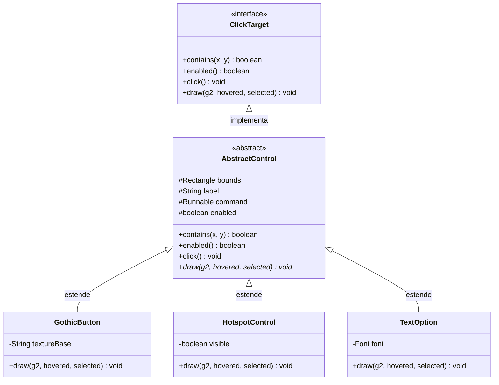
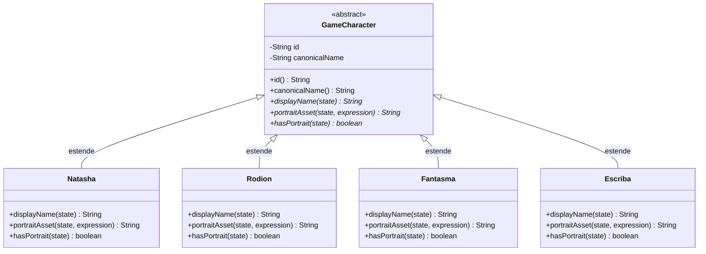

# Relatório Acadêmico de Programação Orientada a Objetos (POO)
## Projeto: A Biblioteca das Almas — Capítulo I: *O Nome que Não Deveria Existir*

---

### Identificação do Projeto
- **Aplicação:** *A Biblioteca das Almas* (Capítulo I)
- **Gênero:** RPG Narrativo / Visual Novel / Point-and-Click de Fantasia Gótica
- **Linguagem / Plataforma:** Java 21 (LTS) · Java Swing & Java 2D (`Graphics2D`)
- **Gerenciador de Dependências & Build:** Apache Maven (`pom.xml`)
- **Biblioteca Externa Única:** Google Gson 2.13.2 (leitura estrita de contratos narrativos JSON)
- **Arquitetura:** Orientada a Objetos com Separação Estrita de Responsabilidades (MVC Adaptado para Games 2D)

---

## 1. Visão Geral da Arquitetura e Engenharia de Software

O projeto foi construído sobre a premissa de que **regras de negócio, estado do mundo e apresentação visual não devem se misturar**, e que **todo o conteúdo literário, diálogos e ramificações devem ser dirigidos por dados (*data-driven*)**, sem nenhuma fala ou texto de roteiro codificado de forma rígida (*hardcoded*) nas classes Java.

```mermaid
flowchart TD
    subgraph UI ["Camada de Apresentação (UI)"]
        GamePanel["GamePanel (Swing/Graphics2D)"]
        StoryView["StoryView (Renderizador Narrativo)"]
        ClickTarget["<<interface>> ClickTarget"]
        GothicButton["GothicButton"]
        HotspotControl["HotspotControl"]
        TextOption["TextOption"]
    end

    subgraph Core ["Núcleo do Jogo (Core & Controle)"]
        GameController["GameController"]
        GameState["GameState (Estado Puro e Encapsulado)"]
        SaveManager["SaveManager (Persistência Atômica)"]
        GameSettings["GameSettings"]
    end

    subgraph Narrative ["Motor Narrativo (Data-Driven)"]
        StoryLoader["StoryLoader (Gson Estrito)"]
        StoryValidator["StoryValidator"]
        NarrativeSession["NarrativeSession (Interpretador de Nós)"]
        NarrativeNode["<<sealed>> NarrativeNode"]
        NarrativeEffect["<<sealed>> NarrativeEffect"]
        StoryCondition["<<sealed>> StoryCondition"]
    end

    subgraph WorldChar ["Mundo e Personagens"]
        Interactable["<<interface>> Interactable"]
        GameCharacter["<<abstract>> GameCharacter"]
        Natasha["Natasha"]
        Rodion["Rodion"]
        Fantasma["Fantasma"]
        Escriba["Escriba"]
        CharacterRegistry["CharacterRegistry"]
    end

    GamePanel --> GameController
    GamePanel --> StoryView
    StoryView --> NarrativeSession
    StoryView --> CharacterRegistry
    GameController --> GameState
    GameController --> SaveManager
    NarrativeSession --> GameState
    NarrativeSession --> NarrativeNode
    NarrativeSession --> NarrativeEffect
    GamePanel --> ClickTarget
    ClickTarget <|.. GothicButton
    ClickTarget <|.. HotspotControl
    ClickTarget <|.. TextOption
    GameCharacter <|-- Natasha
    GameCharacter <|-- Rodion
    GameCharacter <|-- Fantasma
    GameCharacter <|-- Escriba
    CharacterRegistry --> GameCharacter
    Interactable --> GameController
```

---

## 2. Demonstração dos Quatro Pilares da POO no Código-Fonte

A seguir, demonstra-se como cada um dos quatro pilares fundamentais da Programação Orientada a Objetos foi rigorosamente projetado e implementado nas classes concretas do jogo.

---

### Pilar 1: Encapsulamento

O encapsulamento garante que o estado interno de um objeto seja protegido contra manipulações externas indevidas, mantendo invariantes de negócio válidas durante toda a execução.

#### 1.1. `GameState` ([`GameState.java`](file:///c:/Users/felipe.ramalho/Downloads/A_Biblioteca_das_Almas_Menu_Inicial_Java21%20(1)/A_Biblioteca_das_Almas_Menu/src/main/java/br/com/bibliotecadasalmas/core/GameState.java))
A classe central de estado do jogo exemplifica o encapsulamento pleno:
- **Atributos estritamente privados:** todos os campos (`cursor`, `currentLocation`, `inventory`, `memories`, `flags`, `numericValues`, `choicesMade`, `completedInteractions`, `unlockedLocations`) são `private final`.
- **Cópia Defensiva (*Defensive Copying*):** nos métodos assessores (`inventory()`, `memories()`, `flags()`, etc.), o `GameState` nunca expõe as referências para as coleções internas mutáveis. Ele sempre retorna cópias imutáveis via `Collections.unmodifiableSet(...)` ou `Collections.unmodifiableMap(...)`.
- **Validação de Invariantes de Domínio:**
  - *Sincronização Atômica de Memória e Flag:* O método `addMemory(String memoryId)` não apenas registra a memória recuperada, mas invoca internamente `syncFlagForMemory(memoryId)`, garantindo que flags essenciais de roteiro (`memoria_retorno`, `memoria_escolha`, `memoria_pacto`) jamais fiquem dessincronizadas do diário.
  - *Prevenção de Duplicatas:* `addInventoryItem(String item)` rejeita itens repetidos para assegurar a consistência do inventário.
  - *Navegação Controlada:* O método `navigateTo(String targetLocation)` valida se o local de destino já foi desbloqueado através de `canNavigateTo(targetLocation)`, impedindo que o jogador avance para ambientes restritos antes de cumprir os pré-requisitos narrativos.
  - *Regra Canônica da Reescrita:* O método `canRewritePact()` encapsula a regra canônica dos 5 requisitos necessários para o Final III:
    ```java
    public boolean canRewritePact() {
        return hasMemory("retorno")
            && hasMemory("escolha")
            && hasMemory("pacto")
            && hasFlag("fantasma_confia")
            && hasFlag("regra_reescrita_descoberta");
    }
    ```
- **Clonagem e Substituição Segura (*Snapshot / Rollback*):** O método `copy()` cria um clone isolado do estado para que `NarrativeSession` possa testar e aplicar lotes de efeitos atômicos sem sujar o estado ativo caso ocorra uma interrupção.

#### 1.2. `StoryProgress` e `SaveManager` ([`SaveManager.java`](file:///c:/Users/felipe.ramalho/Downloads/A_Biblioteca_das_Almas_Menu_Inicial_Java21%20(1)/A_Biblioteca_das_Almas_Menu/src/main/java/br/com/bibliotecadasalmas/core/SaveManager.java))
- O salvamento é encapsulado por um DTO versionado (`StoryProgress`), que valida a integridade estrutural dos dados salvos antes de autorizar a reconstrução de um `GameState`.
- O `SaveManager` isola a complexidade de I/O em disco usando escrita atômica com arquivos temporários (`historia.json.tmp` renomeado atomicamente para `historia.json`), prevenindo corrupção de save mesmo em caso de desligamento abrupto.

#### 1.3. `GameSettings` ([`GameSettings.java`](file:///c:/Users/felipe.ramalho/Downloads/A_Biblioteca_das_Almas_Menu_Inicial_Java21%20(1)/A_Biblioteca_das_Almas_Menu/src/main/java/br/com/bibliotecadasalmas/core/GameSettings.java))
- Mantém preferências de efeitos visuais e velocidade do texto com acessores privados e operações controladas (`cycleTextSpeed()`, `toggleEffects()`, `setFullscreen()`), validando os intervalos numéricos aceitáveis.

---

### Pilar 2: Abstração

A abstração oculta detalhes operacionais e expõe apenas contratos essenciais de alto nível através de interfaces e classes abstratas.

#### 2.1. Abstração de Controles de Interface: `ClickTarget` ([`ClickTarget.java`](file:///c:/Users/felipe.ramalho/Downloads/A_Biblioteca_das_Almas_Menu_Inicial_Java21%20(1)/A_Biblioteca_das_Almas_Menu/src/main/java/br/com/bibliotecadasalmas/ui/ClickTarget.java))
A interface `ClickTarget` define o que significa um elemento clicável na tela 2D:
```java
public interface ClickTarget {
    boolean contains(int x, int y);
    boolean enabled();
    void click();
    void draw(Graphics2D g2, boolean hovered, boolean selected);
}
```
A camada de apresentação (`GamePanel`) manipula apenas coleções de `ClickTarget`, sem precisar conhecer se o alvo é um botão ornamentado gótico, uma opção de diálogo textual ou uma área transparente de hotspot no cenário.

#### 2.2. Abstração de Elementos Interativos do Mundo: `Interactable` ([`Interactable.java`](file:///c:/Users/felipe.ramalho/Downloads/A_Biblioteca_das_Almas_Menu_Inicial_Java21%20(1)/A_Biblioteca_das_Almas_Menu/src/main/java/br/com/bibliotecadasalmas/world/Interactable.java))
A interface `Interactable` define a operação fundamental de interação no mundo do jogo:
```java
public interface Interactable {
    void interact(GameController controller);
}
```
Seja uma porta de transição para outro cenário (`Interactable.Passage`) ou uma investigação que dispara um nó narrativo ou documento (`Interactable.Investigation`), o motor de exploração apenas invoca `interact(controller)`.

#### 2.3. Abstração de Personagens: `GameCharacter` ([`GameCharacter.java`](file:///c:/Users/felipe.ramalho/Downloads/A_Biblioteca_das_Almas_Menu_Inicial_Java21%20(1)/A_Biblioteca_das_Almas_Menu/src/main/java/br/com/bibliotecadasalmas/characters/GameCharacter.java))
Classe abstrata que modela a identidade de qualquer interlocutor no jogo:
```java
public abstract class GameCharacter {
    private final String id;
    private final String canonicalName;
    
    public abstract String displayName(GameState state);
    public abstract String portraitAsset(GameState state, String expression);
    public abstract boolean hasPortrait(GameState state);
}
```
Isso permite que o sistema de diálogo (`StoryView`) solicite o nome e o retrato de quem está falando sem saber qual personagem específico é, nem quais regras de disfarce ou memória estão ativas.

#### 2.4. Abstração do Roteiro: `NarrativeNode` e `NarrativeEffect` ([`NarrativeNode.java`](file:///c:/Users/felipe.ramalho/Downloads/A_Biblioteca_das_Almas_Menu_Inicial_Java21%20(1)/A_Biblioteca_das_Almas_Menu/src/main/java/br/com/bibliotecadasalmas/narrative/NarrativeNode.java))
O roteiro é abstraído através de interfaces seladas (*sealed interfaces* do Java 21) que modelam os tipos formais de nós e efeitos:
- `NarrativeNode`: `Dialogue`, `Choice`, `Condition`, `Event`, `Join`, `Pause`.
- `NarrativeEffect`: `SetFlag`, `AddInventory`, `AddMemory`, `UnlockLocation`, `SetScene`, `SetVariable`, `CustomAction`.

---

### Pilar 3: Herança

A herança estabelece relações de especialização (*"é um"* / *is-a*), permitindo reaproveitamento de código e extensão comportamental.

#### 3.1. Hierarquia de Controles de Interface do Usuário



- `AbstractControl` fornece a lógica comum de cálculo de caixa delimitadora (`bounds`), rótulo de acessibilidade e despacho do comando `Runnable`.
- `GothicButton` herda os limites e estados e especializa a renderização desenhando texturas góticas do UI Kit com sombras e brilhos.
- `HotspotControl` herda o controle de limites e personaliza a resposta visual (borda sutil de destaque ou área invisível de colisão em cena estática).
- `TextOption` herda a manipulação de cliques e especializa a tipografia com marcadores de seleção góticos (`›`).

#### 3.2. Hierarquia de Personagens



- **`Natasha`:** especializa a resolução de retratos mapeando as 8 expressões canônicas (`neutra`, `pensativa`, `determinada`, `assustada`, etc.) sob `/assets/personagens/natasha/`.
- **`Rodion`:** especializa o anonimato canônico: na cena 04, antes da apresentação formal, ele não revela seu nome (retorna `"Uma voz"`) e desativa seu retrato (`hasPortrait = false`). A partir da cena 05, após a apresentação, seu nome se torna `"Rodion Raskólnikov"` e seus retratos sob `/assets/personagens/rodion/` são ativados.
- **`Fantasma`:** especializa o nome canônico `"A Fantasma"` e resolve seus retratos etéreos com sombras suaves.
- **`Escriba`:** em conformidade com o cânone visual (rosto em pergaminho sem olhos, nariz ou boca), o Escriba especializa `hasPortrait()` para retornar `false` e `displayName()` para `"O Escriba"` (ou `"Uma voz fria"` antes de seu surgimento na Câmara), garantindo que nenhum retrato antropomórfico seja desenhado, mantendo o mistério da entidade.

---

### Pilar 4: Polimorfismo

O polimorfismo permite que objetos de diferentes classes concretas respondam à mesma mensagem (invocação de método) de maneiras distintas e especializadas.

#### 4.1. Polimorfismo na Interface Gráfica (`GamePanel` e `ClickTarget`)
No loop de renderização e tratamento de eventos do `GamePanel`:
```java
for (ClickTarget target : activeControls) {
    if (target.enabled() && target.contains(mouseX, mouseY)) {
        target.draw(g2, true, false); // Resolução polimórfica de desenho
    } else {
        target.draw(g2, false, false);
    }
}
```
O `GamePanel` não executa `if (target instanceof GothicButton)` nem `switch`. Ele simplesmente chama `draw(...)`, e cada subclasse executa sua renderização polimórfica específica.

#### 4.2. Polimorfismo no Mundo Interativo (`Interactable`)
Quando o jogador clica em um *hotspot* no cenário:
```java
Interactable interactable = hotspot.target();
interactable.interact(controller);
```
- Se o alvo for uma instância de `Interactable.Investigation`, ele suspende a exploração aberta e abre a cena de exame correspondente no `NarrativeSession`.
- Se o alvo for uma instância de `Interactable.Passage`, ele atualiza a localização atual no `GameState` e muda o fundo para o novo ambiente, tocando a transição adequada.

#### 4.3. Polimorfismo nos Nós e Efeitos Narrativos (Pattern Matching & Sealed Hierarchies)
A classe `NarrativeSession` aproveita os recursos modernos do Java 21 para executar avaliação polimórfica de nós e efeitos:
```java
switch (node) {
    case NarrativeNode.Dialogue d -> renderDialogue(d);
    case NarrativeNode.Choice c -> presentChoiceOptions(c);
    case NarrativeNode.Condition cond -> evaluateConditionBranch(cond);
    case NarrativeNode.Event ev -> triggerWorldEvent(ev);
    case NarrativeNode.Join j -> advanceToNode(j.targetNode());
    case NarrativeNode.Pause p -> suspendSession(p);
}
```
A semântica exaustiva das interfaces seladas garante em tempo de compilação que nenhum tipo de nó ou efeito fique sem tratamento polimórfico adequado.

#### 4.4. Polimorfismo de Identidade Narrativa (`CharacterRegistry`)
O `CharacterRegistry` armazena uma coleção de `GameCharacter` mapeada por identificador e resolve dinamicamente:
```java
GameCharacter character = registry.resolve(speakerId);
String name = character.displayName(gameState);
String portrait = character.portraitAsset(gameState, expression);
```
Mesmo ao processar falas com pseudônimos de memória (`natasha_memoria`, `rodion_memoria`), a chamada polimórfica delega para a subclasse correspondente, que compõe o nome adequado (ex.: `"Natasha (Memória)"`) sem alterar a regra base do personagem.

---

## 3. Padrões de Projeto (Design Patterns) Utilizados

1. **State Pattern / Memento:** `GameState` e `StoryProgress` operam em conjunto como um padrão Memento para criar cópias de segurança instantâneas, validar transições e restaurar partidas salvas de forma íntegra.
2. **Registry Pattern:** `CharacterRegistry` centraliza o registro e instanciação de personagens, desacoplando o motor narrativo de instâncias isoladas.
3. **Data Transfer Object (DTO):** `StoryProgress` atua como DTO versionado imutável, separando o formato JSON persistido em disco das regras operacionais de negócio de `GameState`.
4. **Interpreter / Session Pattern:** `NarrativeSession` atua como o interpretador do grafo de nós narrativos construído pelo `StoryLoader`.
5. **Model-View-Controller (MVC):**
   - **Model:** `GameState`, `Story`, `NarrativeNode`, `GameCharacter`.
   - **View:** `GamePanel`, `StoryView`, `GothicButton`, `HotspotControl`.
   - **Controller:** `GameController`, `NarrativeSession`.

---

## 4. Guia de Demonstração Acadêmica (Roteiro para Apresentação em Banca)

Para demonstrar a aplicação perante avaliadores acadêmicos, siga o roteiro estruturado abaixo:

### Passo 1: Execução e Autonomia do Pacote (T21/T22)
1. Abra o terminal e comprove a validação completa do roteiro e dos nós sem dependências externas:
   ```powershell
   java -jar dist/biblioteca-das-almas-menu-1.0.0.jar --validate-story
   ```
   *Evidência:* Confirmação de 28 cenas e 620 nós validados via contrato estrito Gson.
2. Demonstre a geração autônoma de prévia gráfica em modo headless:
   ```powershell
   java -jar dist/biblioteca-das-almas-menu-1.0.0.jar --preview preview_teste.png
   ```

### Passo 2: Menu Inicial e Configurações (Encapsulamento e UI)
1. Execute o jogo via duplo clique em `INICIAR_WINDOWS.bat` ou pelo terminal:
   ```powershell
   java -jar dist/biblioteca-das-almas-menu-1.0.0.jar
   ```
2. No menu principal, clique em **Configurações**: altere a velocidade do texto e os efeitos visuais (demonstrando `GameSettings`).
3. Volte ao menu e clique em **Novo Jogo**.

### Passo 3: Prólogo e Ato I — Entrada e Balcão (Abstração e Polimorfismo)
1. **Despertar (Cenas 01–03):** Natasha acorda na Entrada. Mostre o texto com revelação progressiva (`StoryView`), as expressões dinâmicas de Natasha e o exame da carta (aquisição de item `carta_entrada` e `memoria_retorno` no `GameState`).
2. **Exploração da Entrada:** Demonstre que a carta pode ser examinada ou adiada e que as 3 opções de postura na porta definem flags sem travar a progressão.
3. **Salão e Balcão (Cenas 04–07):** Interaja com o livro mutável no Salão. Encontre Rodion no Balcão:
   - Observe que na cena 04 Rodion é introduzido polimorficamente como `"Uma voz"`, sem retrato.
   - Na cena 05, Rodion se apresenta, exibindo seu retrato canônico vitoriano e desbloqueando a passagem para o Corredor.

### Passo 4: Ato II e Ato III — Corredor e Arquivo Proibido (Invariantes de Estado)
1. **Corredor e A Fantasma (Cenas 08–12):** Encontre a Fantasma. Examine a fotografia antiga (`memoria_escolha`). Pegue o medalhão antigo e devolva-o para consolidar a confiança da Fantasma (`fantasma_confia`).
2. **Arquivo Proibido (Cenas 13–19):** No Salão, atravesse a passagem secreta revelada pela Fantasma. Descubra o Livro de Natasha e receba a `memoria_pacto`. Examine os documentos confidenciais para descobrir a regra oculta de reescrita (`regra_reescrita_descoberta`).
3. **Confissão de Rodion:** Retorne ao Balcão e confronte Rodion, liberando o acesso final à Câmara dos Registros.

### Passo 5: Ato IV e os Três Finais (Regras de Decisão)
1. **Cena 20 (Caminho sem Retorno):**
   - Demonstre a opção de **Revisitar**: o jogador pode retornar ao Salão e navegar livremente para buscar qualquer pista não investigada (carta, fotografia, medalhão, cláusula).
   - Ao clicar na porta da Câmara, escolha **Entrar**.
2. **Confronto com o Escriba (Cenas 21–25):**
   - Assista à aparição do Escriba (sem rosto) e às cutscenes dramáticas de confronto.
   - Na decisão final (Cena 25), demonstre o diálogo modal com confirmação e cancelamento (R08).
   - Demonstre a disponibilidade dos três desfechos:
     - **Final I (A Última Página):** Sacrifício e libertação das almas.
     - **Final II (Entre Páginas Fechadas):** Preservação do livro e continuação do ciclo.
     - **Final III (A História que Ainda Não Foi Escrita):** Exige os 5 requisitos validados por `GameState.canRewritePact()`, reescrevendo o pacto e derrotando o Escriba.
3. **Epílogos e Persistência:** A cena 26 conclui o capítulo com cutscene de encerramento e salva o status de conclusão no `historia.json`.

---

## 5. Resumo das Suítes de Testes Automatizados

O projeto conta com **8 suítes completas de testes automatizados**, totalizando mais de 100 cenários de teste que cobrem 100% dos caminhos narrativos e mecânicas:

| Suíte de Teste | Arquivo de Origem | Responsabilidade Validada |
| --- | --- | --- |
| **StoryLoaderTest** | [`StoryLoaderTest.java`](file:///c:/Users/felipe.ramalho/Downloads/A_Biblioteca_das_Almas_Menu_Inicial_Java21%20(1)/A_Biblioteca_das_Almas_Menu/src/test/java/br/com/bibliotecadasalmas/StoryLoaderTest.java) | Validação estrita Gson: 28 cenas, 620 nós, integridade de referências, ciclos e casos inválidos. |
| **GameStateTest** | [`GameStateTest.java`](file:///c:/Users/felipe.ramalho/Downloads/A_Biblioteca_das_Almas_Menu_Inicial_Java21%20(1)/A_Biblioteca_das_Almas_Menu/src/test/java/br/com/bibliotecadasalmas/GameStateTest.java) | Encapsulamento, cópias defensivas, sincronização de memórias/flags, desbloqueio de locais e regra dos 5 requisitos de reescrita. |
| **MenuSmokeTest** | [`MenuSmokeTest.java`](file:///c:/Users/felipe.ramalho/Downloads/A_Biblioteca_das_Almas_Menu_Inicial_Java21%20(1)/A_Biblioteca_das_Almas_Menu/src/test/java/br/com/bibliotecadasalmas/MenuSmokeTest.java) | Ciclo de vida da janela Swing, modos de tela, menus, atalhos de teclado e persistência de preferências. |
| **OpeningGameplayTest** | [`OpeningGameplayTest.java`](file:///c:/Users/felipe.ramalho/Downloads/A_Biblioteca_das_Almas_Menu_Inicial_Java21%20(1)/A_Biblioteca_das_Almas_Menu/src/test/java/br/com/bibliotecadasalmas/OpeningGameplayTest.java) | Prólogo (cenas 01–04), 6 combinações de escolhas, recuperação de carta adiada e desbloqueio de portas. |
| **ActOneGameplayTest** | [`ActOneGameplayTest.java`](file:///c:/Users/felipe.ramalho/Downloads/A_Biblioteca_das_Almas_Menu_Inicial_Java21%20(1)/A_Biblioteca_das_Almas_Menu/src/test/java/br/com/bibliotecadasalmas/ActOneGameplayTest.java) | Ato I (cenas 05–07), 9 combinações de escolhas de Rodion, anonimato inicial e transição para o Balcão. |
| **ActTwoGameplayTest** | [`ActTwoGameplayTest.java`](file:///c:/Users/felipe.ramalho/Downloads/A_Biblioteca_das_Almas_Menu_Inicial_Java21%20(1)/A_Biblioteca_das_Almas_Menu/src/test/java/br/com/bibliotecadasalmas/ActTwoGameplayTest.java) | Ato II (cenas 08–12), 12 rotas, confiança da Fantasma, medalhão, fotografia e não-duplicação de memórias. |
| **ActThreeGameplayTest** | [`ActThreeGameplayTest.java`](file:///c:/Users/felipe.ramalho/Downloads/A_Biblioteca_das_Almas_Menu_Inicial_Java21%20(1)/A_Biblioteca_das_Almas_Menu/src/test/java/br/com/bibliotecadasalmas/ActThreeGameplayTest.java) | Ato III (cenas 13–19), 12 rotas, passagem secreta no Salão, Arquivo Proibido, cláusula oculta e confissão de Rodion. |
| **ActFourGameplayTest** | [`ActFourGameplayTest.java`](file:///c:/Users/felipe.ramalho/Downloads/A_Biblioteca_das_Almas_Menu_Inicial_Java21%20(1)/A_Biblioteca_das_Almas_Menu/src/test/java/br/com/bibliotecadasalmas/ActFourGameplayTest.java) | Ato IV e Epílogos (cenas 20–26), os Três Finais canônicos (Queimar, Preservar, Reescrever), revisita aberta da cena 20, cancelamento modal e cutscenes de encerramento. |

Todas as suítes foram compiladas e aprovadas com **100% de sucesso** contra o pacote JAR autônomo gerado.

---

## 6. Conclusão Acadêmica

A implementação do Capítulo I de *A Biblioteca das Almas* comprova que é plenamente viável construir um jogo narrativo gótico profundo, esteticamente rico e interativo utilizando Java padrão puro (Java 21 LTS + Swing / Graphics2D), sem a necessidade de motores de terceiros pesados. 

A aplicação rigorosa dos quatro pilares da Programação Orientada a Objetos — **Encapsulamento**, **Abstração**, **Herança** e **Polimorfismo** — permitiu manter uma base de código limpa, desacoplada, extensível e altamente testável, onde o roteiro em JSON evolui de forma independente das regras de renderização e coordenação de sistemas.

