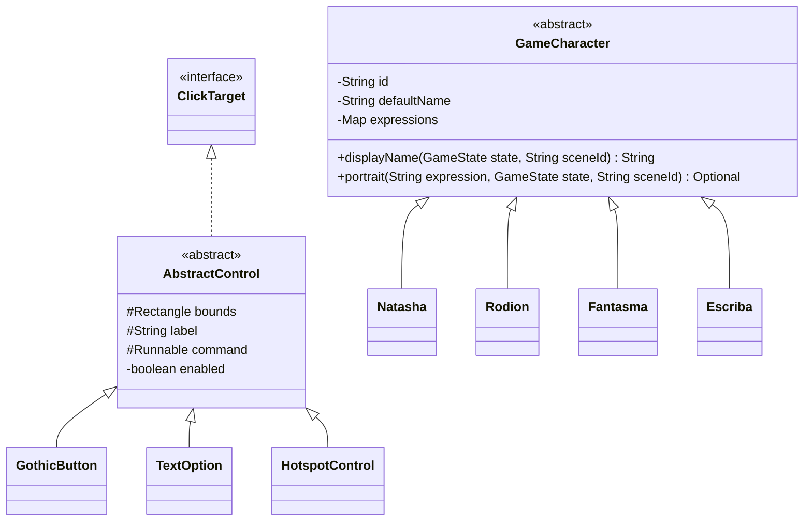

# Relatório Acadêmico de Programação Orientada a Objetos

**A Biblioteca das Almas — Capítulo I: O Nome que Não Deveria Existir**
Revisão: **11/11/2026**, commit `389433f`.

Equipe: **Felipe Nunes Ramalho** (26154726) e **Juliana Karla Camargo da Silva** (26154769).
UniSenai — ADS/TADS2 — BackEnd — Professor Cainã Antunes.

Este relatório demonstra os quatro pilares usando nomes e assinaturas existentes no código. A [documentação acadêmica](documentacao-academica.md) contém a matriz dos requisitos do professor. A [arquitetura](arquitetura-e-poo.md) detalha as dependências, e [Testes do capítulo](testes-do-capitulo.md) registra os resultados.

## 1. Escopo

Java 21, Swing, Graphics2D, Maven e Gson 2.13.2 sustentam a aventura narrativa por cliques. O consolidado contém 28 entradas de cena e 620 nós, com configuração para os quatro atos e três epílogos.

A separação de estado, coordenação, dados e apresentação permite explicar responsabilidades sem criar uma classe para cada fala. O conteúdo narrativo atual vem dos JSONs; o fluxo legado em `GamePanel` ainda contém texto fixo para compatibilidade com saves antigos.

## 2. Encapsulamento

[GameState.java](../src/main/java/br/com/bibliotecadasalmas/core/GameState.java) protege as coleções e concentra operações que preservam as regras:

| Operação existente | Regra demonstrada |
| --- | --- |
| `giveItem(String)` | Valida o identificador e usa um conjunto, evitando itens duplicados. |
| `unlockMemory(String)` / `setFlag(String, boolean)` | Mantêm a memória e a flag correspondente sincronizadas. |
| `moveToLocation(String)` | Recusa destino ainda bloqueado. |
| `inventory()`, `memories()`, `flags()` | Retornam cópias imutáveis. |
| `copy()` / `replaceWith(GameState)` | Permitem preparar e publicar um candidato de estado. |
| `canRewritePact()` | Concentra os cinco requisitos da reescrita. |

Trecho existente:

```java
public boolean canRewritePact() {
    return hasMemory("retorno") && hasMemory("escolha") && hasMemory("pacto")
            && flag("fantasma_confia") && flag("regra_reescrita_descoberta");
}
```

Nem todos os atributos são finais: local e cursor mudam por operações controladas. Os campos protegidos de `AbstractControl` também fazem parte do desenho atual.

[GameCharacter.java](../src/main/java/br/com/bibliotecadasalmas/characters/GameCharacter.java) mantém `id`, `defaultName` e `expressions` privados e finais, copiando o mapa de expressões para uma visão não modificável.

[SaveManager.java](../src/main/java/br/com/bibliotecadasalmas/core/SaveManager.java) encapsula os arquivos. A gravação usa temporário e solicita substituição atômica, com alternativa comum quando o sistema não suporta `ATOMIC_MOVE`. Isso não garante imunidade a qualquer falha de armazenamento.

## 3. Abstração

[ClickTarget.java](../src/main/java/br/com/bibliotecadasalmas/ui/ClickTarget.java) define o contrato de um controle:

```java
public interface ClickTarget {
    boolean contains(int x, int y);
    boolean enabled();
    void click();
    void draw(Graphics2D graphics, boolean hovered, boolean selected);
}
```

[Interactable.java](../src/main/java/br/com/bibliotecadasalmas/world/Interactable.java) oferece a operação `interact(GameController)`, implementada por `Investigation` e `Passage`.

`GameCharacter` oferece a abstração de interlocutor, compartilhando identidade e retratos. A classe é abstrata, mas seus métodos de nome/retrato têm implementação:

```java
public String displayName(GameState state, String sceneId) {
    return defaultName;
}

public Optional<String> portrait(String expression, GameState state, String sceneId) {
    if (expression == null) return Optional.empty();
    return Optional.ofNullable(expressions.get(expression));
}
```

[NarrativeNode.java](../src/main/java/br/com/bibliotecadasalmas/narrative/NarrativeNode.java) usa os tipos `Line`, `Cutscene`, `Choice`, `Branch`, `Event`, `Join` e `End`. [NarrativeEffect.java](../src/main/java/br/com/bibliotecadasalmas/narrative/NarrativeEffect.java) usa `SetFlag`, `SetValue`, `GiveItem`, `RemoveItem`, `UnlockMemory` e `UnlockLocation`. Esses são os nomes dos records existentes.

## 4. Herança



As subclasses de `AbstractControl` reutilizam limites e acionamento e especializam `draw`. `HotspotControl` sobrescreve também `contains`.

As quatro classes de personagem configuram seus mapas no construtor. [Rodion.java](../src/main/java/br/com/bibliotecadasalmas/characters/Rodion.java) sobrescreve `displayName` e `portrait`: na cena 04, retorna “Uma voz” e nenhum retrato; nas demais, usa a identidade padrão.

O Escriba tem retratos cadastrados. Seu rosto sem feições é uma característica visual; não há método `hasPortrait` que oculte todas as suas imagens. O alias `voz_escriba` é tratado pelo registro sem retrato.

## 5. Polimorfismo

Em `GamePanel`, o mesmo contrato desenha controles diferentes:

```java
for (int i = 0; i < controls.size(); i++) {
    controls.get(i).draw(g, i == hover, i == keyboardSelection);
}
```

Na exploração, `h.interaction().interact(this)` despacha a ação para investigação ou passagem. No [CharacterRegistry.java](../src/main/java/br/com/bibliotecadasalmas/characters/CharacterRegistry.java), `Map<String, GameCharacter>` permite consultar personagens pelo tipo base e executar a implementação concreta de nome/retrato.

Os aliases de memória recebem nomes de apresentação no registro e reutilizam os retratos do personagem. Isso é diferente de declarar novas subclasses para cada lembrança.

O pattern matching do executor seleciona o tratamento dos tipos selados. O exemplo direto de despacho virtual é a chamada de um método sobrescrito, como `draw` ou `Rodion.displayName`.

## 6. Organização e persistência

A organização separa modelo (`GameState`, roteiro e personagens), apresentação (`GamePanel`, `StoryView`, controles) e coordenação (`GameController`, `NarrativeSession`). É uma descrição de responsabilidades, não comprovação de implementação formal de todos os padrões clássicos.

`CharacterRegistry` centraliza identidades. `StoryProgress` é um DTO em record, formato 1, que separa o JSON salvo do estado de execução. `NarrativeSession` interpreta o grafo narrativo e aplica lotes sobre uma cópia do estado.

Há suporte a persistência de cursor, escolhas e marcas dos atos posteriores. A revisita da cena 20 depende das marcas e pausas configuradas; não existe um campo genérico de contexto suspenso no save.

## 7. Demonstração acadêmica

1. Mostrar a identificação e a matriz de requisitos na [documentação acadêmica](documentacao-academica.md).
2. Validar o JAR: `java -jar dist/BibliotecaDasAlmas-Menu.jar --validate-story`.
3. Executar Novo Jogo e demonstrar carta, escolha e consulta de inventário/diário.
4. Abrir os contratos e as duas hierarquias para explicar abstração e herança.
5. Mostrar inventário protegido, memória/flag e navegação em `GameState`.
6. Mostrar os três exemplos de despacho: controles, interações e identidade de Rodion.
7. Demonstrar os atos seguintes, confirmação da decisão e Continuação, conforme os casos registrados nos testes.
8. Apresentar os resultados atuais sem atribuir cobertura total ou validação manual a testes de lógica.

A demonstração deve distinguir os seis ambientes lógicos dos fundos compartilhados. Exigências de áudio, colisão, movimento, tela cheia inicial e Esc imediato continuam com o estado registrado na matriz acadêmica.

## 8. Evidências e limites

Existem oito programas de teste com `main`: `StoryLoaderTest`, `GameStateTest`, `OpeningGameplayTest`, `ActOneGameplayTest`, `ActTwoGameplayTest`, `ActThreeGameplayTest`, `ActFourGameplayTest` e `MenuSmokeTest`.

Na revisão de 11/11/2026, os oito passaram contra as fontes recompiladas. Os testes de atos percorrem o controlador e o executor; `MenuSmokeTest` exercita cliques e teclado da abertura sem abrir janela. Não há relatório de cobertura de 100%, nem validação automatizada da aparência de todas as falas.

Procedimentos, evidências do pacote e limitações estão em [Testes do capítulo](testes-do-capitulo.md). Créditos individuais por recurso e ferramentas utilizadas ainda devem ser registrados pela dupla.

